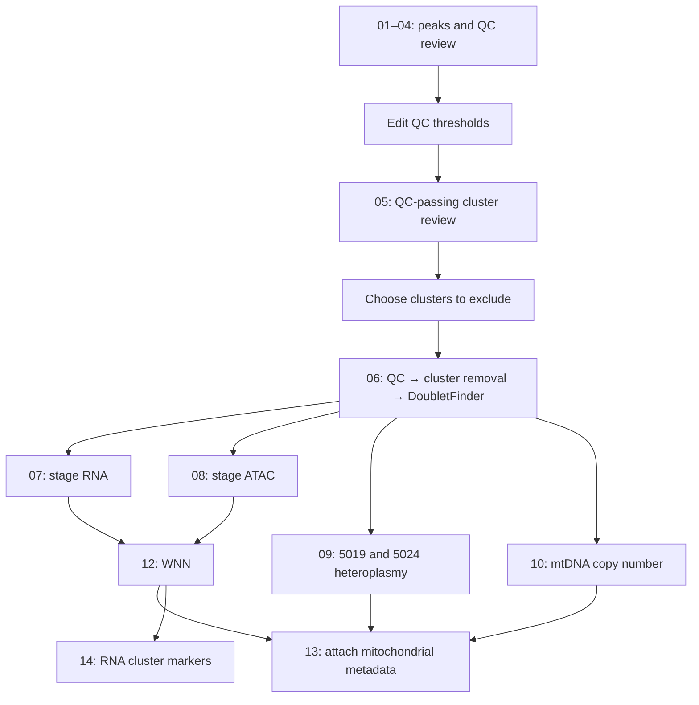

# Per-stage mouse mitochondrial-variant Multiome workflow

This Nextflow workflow analyses one mouse developmental stage at a time (mm10). It calls peaks from each sample’s ATAC fragments, creates one common peak set for the stage, reviews eight RNA/ATAC QC metrics, removes reviewed low-quality clusters and RNA doublets per sample, preprocesses and integrates RNA and ATAC, estimates mtDNA copy number, builds WNN clusters, attaches heteroplasmy and copy-number metadata, and identifies RNA markers for each WNN cluster.

## Requirements and inputs

Use Nextflow with Java 17 or later. Load Java before installing or running Nextflow:

```bash
# Example (Cambridge MBU cluster)
module add java/17
curl -s https://get.nextflow.io | bash

# nextflow has been downloaded to
# /suffolk/WorkGenomicsD/yy605/software
# add the folder to your PATH
echo 'export PATH="/suffolk/WorkGenomicsD/yy605/software:$PATH"' >> ~/.bashrc
export NXF_HOME=/suffolk/WorkGenomicsD/yy605/.nextflow
source ~/.bashrc
```

The installation command creates a `nextflow` executable in the current directory. Use `./nextflow` there, or place it in a directory on your `PATH` to use the `nextflow` commands below.

Use these existing environments when running this project:

| JSON parameter | Path |
| --- | --- |
| `conda_env` | `/suffolk/WorkGenomicsD/yy605/conda_env/stage_multiome` |
| `macs3_path` | `/suffolk/WorkGenomicsD/yy605/conda_env/macs3/bin/macs3` |

Enable the Conda profile with `-profile conda` for local execution or `-profile slurm,conda` for Slurm. Nextflow uses the R environment above for each task and calls MACS3 through its explicit executable path. Both paths must be accessible on every execution node.

Package versions for the existing `stage_multiome` Conda environment are recorded in [environment.yml](environment.yml). This is an exported Linux environment, including its dependencies and installation prefix. Step 12 also requires your installed `SCP` package in the shared R environment.

The sample CSV must contain only `stage,sample_id,arc_out,mgatk_enriched_dir,mgatk_dir`; see [examples/samples.csv](examples/samples.csv). For example:

```csv
stage,sample_id,arc_out,mgatk_enriched_dir,mgatk_dir
E8.5,5019_Hi_1,/path/to/arc/outs,/path/to/mgatk_enriched/final,
```

`ALL_STAGE` is reserved for combined QC summaries. Sample IDs must be unique within each stage, start with a letter or number, and contain only letters, numbers, `_`, `.` or `-`. Sample IDs are workflow labels and do not need to match upstream Cell Ranger or mgatk run names; the paths must identify the corresponding sample outputs, and sample-specific pipeline JSON keys must match these IDs. All execution nodes must be able to read the absolute input paths:

| Input | Required content |
| --- | --- |
| `arc_out` | Cell Ranger ARC `outs` directory containing `filtered_feature_bc_matrix.h5`, `atac_fragments.tsv.gz` and its `.tbi` index; analysis also requires `summary.csv` for detected-cell reporting and `atac_possorted_bam.bam` for step 10; `per_barcode_metrics.csv` supplies barcode translation when present |
| `mgatk_enriched_dir` | Required mgatk output used for step 09 heteroplasmy/depth metrics, readable by `Signac::ReadMGATK`, usually the `final` directory |
| `mgatk_dir` | Ordinary mgatk output used automatically by step 10 for `mtDNA_CN_normalised`; may be blank, in which case this estimate remains `NA` |

Step 09 heteroplasmy/depth measurements use `mgatk_enriched_dir`. During analysis, step 10 uses both CSV directories and step 13 attaches its results automatically. Supply `mgatk_dir` to calculate the ordinary-mgatk estimate as well. The current `examples/samples.csv` supplies both paths. Leave `mgatk_dir` blank for samples without an ordinary mgatk result. For WT samples, both columns may point to the same output; their two copy-number estimates then use the same mitochondrial depth. The chosen enriched output may have any directory name, including a WT directory without an `_enriched` suffix. Both sources are matched to the retained singlet barcodes.

Gene symbols, the reference genome and barcodes are requirements for the existing data, not additional files or CSV columns:

| Data requirement | Where it comes from |
| --- | --- |
| Mouse gene symbols | Gene names stored in ARC’s `filtered_feature_bc_matrix.h5`; cell-cycle scoring and sex inference require symbols rather than Ensembl IDs |
| mm10 reference | ARC and mgatk outputs must use a compatible mm10 reference; the workflow supplies mm10 gene annotation through `EnsDb.Mmusculus.v79` and validates mgatk reference alleles at the ten mitochondrial sites listed in Step 09 (including A at position 5019). No reference FASTA is supplied to this workflow |
| Matching original 10x barcodes | Cell identifiers already stored in ARC and mgatk outputs; the workflow uses them to match mitochondrial measurements to retained cells. At least some retained cells must match; unmatched cells retain missing mgatk measurements |

Set `samples` to your sample CSV path and `stage` to the stage to analyse in the JSON supplied with `-params-file`. For example, `"stage": "E8.5"` selects all rows labelled `E8.5`, including WT and mutant samples, and excludes other stages. Matching is case-sensitive; the workflow stops if no rows match.

Selected samples share a common peak set and are merged for stage-level RNA, ATAC and WNN analysis during the analysis phase. Outputs are written under `<outdir>/<stage>/`, such as `<outdir>/E8.5/`. Use the same `stage` for review, cluster review and analysis.

Set `macs3_path` to the absolute MACS3 executable path and, when using the Conda profile, set `conda_env` to the existing environment path. One JSON contains these run parameters and all analysis settings. Nextflow loads it with `-params-file`; see the [Nextflow parameter-file documentation](https://docs.seqera.io/nextflow/reference/cli/run#-params-file).

## Run order: review, cluster review, analysis

Run all phases from the project directory with the same Nextflow work directory, `outdir` and `stage`. With `-resume`, unchanged upstream tasks can be reused. Use `-profile conda` for local execution, or `-profile slurm,conda` on Slurm. [site.config](site.config) contains process CPUs, memory and running times; queue/account settings can be added there when required by your cluster.

Supply your complete `/absolute/path/pipeline_settings.json` from the start. Use your existing file or copy [examples/pipeline_settings.example.json](examples/pipeline_settings.example.json) and edit its paths and settings. The example includes your shared R environment and MACS3 executable paths. The workflow does not create or overwrite this file. Relative paths resolve from the directory where you launch Nextflow; absolute paths are clearer when running on the cluster.

First run `--phase review` to review raw QC distributions. This phase uses the `peaks` settings and does not apply QC thresholds. Omitted peak widths default to 20 and 10,000 bp.

```bash
nextflow run main.nf \
  -params-file /absolute/path/pipeline_settings.json \
  --phase review \
  -profile slurm,conda -c site.config -resume
```

Inspect `<outdir>/<stage>/qc/review/`, then edit the QC bounds in that same JSON. Thresholds in the example are illustrative, not recommendations for your samples. Every shared QC metric needs at least one numeric bound before cluster review or analysis. Keep peak limits unchanged across all phases; changing them requires rerunning review and cluster review.

Next inspect QC-passing clusters with `--phase cluster_review`:

```bash
nextflow run main.nf \
  -params-file /absolute/path/pipeline_settings.json \
  --phase cluster_review \
  -profile slurm,conda -c site.config -resume
```

Inspect `<outdir>/<stage>/qc/cluster_review/`: per-cell cluster assignments, cluster-level QC summaries, violin plots and RNA markers. Add any low-quality cluster IDs to `doublet.exclude_clusters` for the corresponding sample. Empty exclusions mean no additional cluster removal; the workflow does not automatically identify low-quality biological populations. Analysis requires each sample's saved `<sample>.cluster_cells.tsv` in this folder. If QC thresholds, `review_QC_cluster` settings, input data, seeds or package versions change, review the resulting clusters again because their IDs may change.

Preserve the QC thresholds and `review_QC_cluster` settings used to generate those tables. Analysis uses their exact saved cluster labels. Finally run `--phase analysis` with your reviewed settings:

```bash
nextflow run main.nf \
  -params-file /absolute/path/pipeline_settings.json \
  --phase analysis \
  -profile slurm,conda -c site.config -resume
```

After each sample finishes step 06, `MGATK_METRICS` and `MTDNA_COPY_NUMBER` can be submitted independently. Stage-level RNA and ATAC preprocessing start once all selected samples have finished step 06. These four branches can run concurrently when Nextflow and the cluster have capacity. `WNN_STAGE` waits for RNA and ATAC outputs. `DEG_STAGE` uses its completed `wnn.rds` directly and can run while mitochondrial tasks finish. `ADD_MGATK` waits for WNN plus all mgatk and copy-number tables.



Step 00 supplies shared functions. Step 11 is a legacy helper and is not invoked by Nextflow; step 12 combines the modalities.

## Pipeline settings JSON

Supply this file through `-params-file`. It contains both run parameters and analysis sections at the top level. The sections below follow the workflow order; JSON key order itself does not affect execution. See [examples/pipeline_settings.example.json](examples/pipeline_settings.example.json) for the complete structure. Its QC thresholds are illustrative and must be reviewed for your samples.

Section and parameter names are case-sensitive. Unknown parameters/sections and invalid sample-specific settings are rejected. Use unique JSON keys. Every shared QC metric must have valid bounds; sample overrides replace the bounds for their named metrics.

| JSON section | Parameters | Script that uses them |
| --- | --- | --- |
| Run parameters | `samples`, `stage`, `outdir`, `macs3_path`, `conda_env` | `main.nf`; `nextflow.config` uses the environment and output paths |
| `peaks` | `peak_min`, `peak_max` | `main.nf` reads the limits and passes them to `02_consensus_peaks.R` |
| `thresholds` | `min`, `max` for each of the eight QC metrics | `05_review_clusters.R`, `06_qc_doubletfinder.R` |
| `sample_overrides` | Per-sample `min`, `max` for selected QC metrics | `05_review_clusters.R`, `06_qc_doubletfinder.R` |
| `review_QC_cluster` | `RNA_dims`, `algorithm`, `resolution` | `05_review_clusters.R` |
| `doublet` | `PC_dims`, `algorithm`, `resolution`, `exclude_clusters`; optional `expected_rate`, `sample_rates` | `06_qc_doubletfinder.R` |
| `RNA_processing` | `RNA_dims`, `RNA_umap_dims`, `algorithm`, `resolution`, `integrate_rna` | `07_preprocess_rna.R` |
| `ATAC_processing` | `ATAC_dims`, `ATAC_integrate_dims`, `algorithm`, `resolution`, `integrate_atac`, `min_cutoff` | `08_preprocess_atac.R` |
| `copy_number` | `bin_size`, `quantile`, `mapq`, `baseq`, `ploidy`, `min_nuclear_bases`, `min_mt_depth`, `keep_duplicates`, `reference_bed`, `blacklist` | `10_estimate_mtdna_copy_number.R` |
| `WNN` | `RNA_dims`, `ATAC_dims`, `algorithm`, `resolution` | `12_wnn_stage.R` |

Nextflow loads the supplied parameter file into `params`. `main.nf` uses `lib/PipelineSettings.groovy` to separate run parameters from analysis sections and validate complete settings for cluster review and analysis. It passes each task only its relevant settings as `val` inputs and writes a small `process_settings.json` inside that task’s work directory. `scripts/00_common.R` validates these task settings and supplies the shared QC/clustering helpers. RNA and ATAC preprocessing receive the required component count, calculated from their own ranges and the corresponding WNN range. `12_wnn_stage.R` reads `RNA_processing.integrate_rna` and `ATAC_processing.integrate_atac` to select integrated or unintegrated reductions. Each step’s clustering algorithm and resolution come only from its own section.

The `algorithm` key uses Seurat’s clustering algorithm codes in every analysis section:

| Value | Clustering algorithm |
| --- | --- |
| `1` | Louvain |
| `2` | Louvain with multilevel refinement |
| `3` | SLM (Smart Local Moving) |
| `4` | Leiden |

The configuration defaults to `3`. See [Seurat `FindClusters`](https://satijalab.org/seurat/reference/findclusters) for the algorithm definitions.

**Run parameters:** set these in the same JSON, before the analysis sections:

```json
"samples": "/suffolk/WorkGenomicsD/yy605/Stage_Multiome_Nextflow/examples/samples.csv",
"stage": "E8.5",
"outdir": "/suffolk/WorkGenomicsD/yy605/Stage_Multiome_Nextflow/stage_results",
"macs3_path": "/suffolk/WorkGenomicsD/yy605/conda_env/macs3/bin/macs3",
"conda_env": "/suffolk/WorkGenomicsD/yy605/conda_env/stage_multiome"
```

Select the phase on the command line with `--phase review`, `--phase cluster_review` or `--phase analysis`; the default is `review`. Keep phase selection outside the JSON so you can reuse the same settings file for all three runs. `outdir` is the output root; stage results go under `<outdir>/<stage>/`. Keep `samples`, `stage`, `outdir` and peak limits consistent across phases. Profiles and process resources remain Nextflow configuration options (`-profile` and `-c site.config`).

**1\. `peaks`: common peak widths.** Used from the initial review phase, before QC metrics are calculated. Both width boundaries are excluded. Omitted settings default to 20 and 10,000 bp; keep them consistent across all phases.

```json
"peaks": {
  "peak_min": 20,
  "peak_max": 10000
}
```

**2\. `thresholds`: shared cell QC limits.** After reviewing the distributions, edit `min` and `max` for all eight metrics in your pipeline JSON. Each metric needs at least one numeric bound; `null` disables one side. Cells must pass all eight metrics, bounds are inclusive, and non-finite values fail QC. These thresholds are applied before clustering in 05 and again in 06. For example, one metric entry is:

```json
"nCount_RNA": {"min": 1000, "max": 40000}
```

This entry belongs inside `thresholds` and keeps cells with 1,000–40,000 RNA counts, including both endpoints. Shared limits apply to every sample unless overridden below. Use `min` to require a minimum value and `max` to reject values above an upper limit; for example, `"percent.mt": {"min": null, "max": 10}` keeps cells with at most 10% mitochondrial RNA. Include both keys even when one is `null`; they cannot both be `null`. The complete example lists all eight required metrics.

**3\. `sample_overrides`: optional sample-specific QC limits.** For each listed metric, both sample-specific bounds replace the shared bounds. Unlisted metrics retain their shared limits. Overrides may be stricter or more permissive; choose them from the sample’s QC distributions. Keys must match CSV `sample_id` values. Leave this section as `{}` for shared thresholds only.

```json
"sample_overrides": {
  "5019_Hi_1": {"nCount_RNA": {"min": 1200, "max": 35000}}
}
```

With the shared RNA count limits above, `5019_Hi_1` instead keeps cells with 1,200–35,000 RNA counts; its other seven metrics still use `thresholds`. All other samples keep the shared 1,000–40,000 range. To change only one bound, repeat the other bound in the override: `{"min": 1200, "max": 40000}`. Setting an override bound to `null` removes that side’s limit for that sample; it does not inherit the shared bound.

**4\. `review_QC_cluster`: per-sample cluster review in 05.** These settings apply after cell QC, before you choose clusters to remove. `RNA_dims` selects PCs for neighbours and clustering. Algorithm 3 is SLM; `resolution` controls cluster granularity.

```json
"review_QC_cluster": {
  "RNA_dims": "1:20",
  "algorithm": 3,
  "resolution": 2
}
```

**5\. `doublet`: reviewed-cluster removal and DoubletFinder in 06.** This step removes the listed 05 cluster IDs, then uses its own algorithm and resolution for homotypic-correction clustering. `PC_dims` controls neighbours, clustering, the pK sweep, DoubletFinder and UMAP. PCA computes 50 components; the range must start at PC1 and end at or below PC50. Cluster IDs below are examples only; use `{}` when none should be removed.

```json
"doublet": {
  "PC_dims": "1:20",
  "algorithm": 3,
  "resolution": 2,
  "exclude_clusters": {"5019_Hi_1": ["3", "7"]}
}
```

By default, the expected rate is estimated from ARC’s detected-cell count using `nextgem_multiome_doublet_rate()`. The expected doublet count is adjusted for homotypic doublets. Numeric `expected_rate` and `sample_rates` remain optional overrides; omit both to use ARC-based estimation. See Step 06 for the Next GEM Multiome assumption and supported count range.

**6\. `RNA_processing`: RNA analysis in 07.** `RNA_dims` controls per-sample and stage RNA neighbours/clustering and CCA anchors. `RNA_umap_dims` controls both stage RNA UMAPs. These clusters use this section’s algorithm and resolution. `integrate_rna` enables CCA integration between samples; it requires at least two samples. Set it to `false` for a single-sample stage.

```json
"RNA_processing": {
  "RNA_dims": "1:20",
  "RNA_umap_dims": "1:50",
  "algorithm": 3,
  "resolution": 2,
  "integrate_rna": true
}
```

**7\. `ATAC_processing`: ATAC analysis in 08.** `ATAC_dims` controls neighbours, clustering, UMAP and reciprocal-LSI anchors. `ATAC_integrate_dims` selects components corrected during integration. When integration is enabled, this range must start at component 1 to preserve downstream component numbering and cover every component requested by both `ATAC_processing.ATAC_dims` and `WNN.ATAC_dims`. The [Signac integration tutorial](https://stuartlab.org/signac/articles/integrate_atac#integration) uses `dims = 2:30` for anchors, `dims.to.integrate = 1:30` for correction, and `dims = 2:30` for the integrated UMAP. Our defaults follow the same pattern with `2:40` and `1:40`: component 1 is retained in the corrected reduction but excluded from anchors, neighbours, clustering, UMAP and WNN by the default analysis ranges.

`min_cutoff = "q5"` selects peaks above the 5th percentile of total counts for LSI (approximately the top 95%; tied counts can affect the proportion), retaining all peaks in the raw assay. This cutoff is applied separately to each sample and again to the merged stage object. The pipeline accepts percentile strings from `"q0"` to below `"q100"`, or nonnegative integer count thresholds; `10`, for example, selects peaks with more than 10 total counts. See [Signac `FindTopFeatures`](https://stuartlab.org/signac/reference/findtopfeatures). Set `integrate_atac` to `false` for a single-sample stage.

```json
"ATAC_processing": {
  "ATAC_dims": "2:40",
  "ATAC_integrate_dims": "1:40",
  "algorithm": 3,
  "resolution": 2,
  "integrate_atac": true,
  "min_cutoff": "q5"
}
```

**8\. `copy_number`: per-sample mtDNA copy-number estimation in 10.** `bin_size` and `quantile` control nuclear reference selection; `mapq`, `baseq` and `keep_duplicates` control BAM counting. `ploidy` supplies the nuclear copy-number assumption. `min_nuclear_bases` and `min_mt_depth` flag low coverage. These defaults are starting settings; match the counting filters to your mgatk runs.

```json
"copy_number": {
  "bin_size": 500,
  "quantile": 0.985,
  "mapq": 30,
  "baseq": 20,
  "ploidy": 2,
  "min_nuclear_bases": 1000,
  "min_mt_depth": 10,
  "keep_duplicates": false,
  "reference_bed": null,
  "blacklist": null
}
```

With `reference_bed: null`, each sample selects nuclear intervals from its ARC fragments. Set `reference_bed` to an absolute shared BED path to use the same intervals for every sample. `blacklist: null` uses Signac’s bundled mm10 blacklist during reference selection; an absolute BED path overrides it. A supplied reference BED is used as-is and must already exclude blacklist regions. Omitted settings use the defaults above.

**9\. `WNN`: combined RNA/ATAC analysis in 12.** Its own `RNA_dims` and `ATAC_dims` select components for multimodal neighbours; its algorithm and resolution control final `wsnn` clusters. WNN uses integrated reductions when the respective RNA/ATAC integration switch is enabled. RNA and ATAC preprocessing compute enough components for these independent WNN ranges.

```json
"WNN": {
  "RNA_dims": "1:20",
  "ATAC_dims": "2:40",
  "algorithm": 3,
  "resolution": 2,
  "plot_point_size": 0.1,
  "lineage_assay": "SCT",
  "lineage_markers": ["Pou3f1", "Foxa1", "Pdgfra"]
}
```

`WNN.plot_point_size` controls cell points in both PDFs. `lineage_assay` selects normalized expression for the blended lineage plot (default `SCT`, `data` slot); `lineage_markers` contains the mouse gene symbols to display. These settings are used only by `12_wnn_stage.R`.

All dimension strings are inclusive: `"1:20"` selects components 1–20. Each analysis section has independent defaults matching the examples above; changing one section does not change another section’s clustering settings.

## Output files and directory structure

Published results are organised under `<outdir>/<stage>/`. For example, `"outdir": "stage_results"` and `"stage": "E8.5"` in your parameter file create the structure below after completing all three phases. `<sample>` is the `sample_id` from your CSV, and per-sample files are repeated for each selected sample.

```text
stage_results/
└── E8.5/
    ├── peaks/
    │   ├── sample/
    │   │   └── <sample>.bed
    │   └── common_peaks.bed
    ├── qc/
    │   ├── review/
    │   │   ├── all_cells_qc_metrics.tsv
    │   │   ├── qc_summary.tsv
    │   │   ├── qc_mad_candidates.tsv
    │   │   └── stage_qc_distributions.pdf
    │   ├── cluster_review/
    │   │   ├── <sample>.cluster_cells.tsv
    │   │   ├── <sample>.cluster_summary.tsv
    │   │   ├── <sample>.cluster_qc.pdf
    │   │   └── <sample>.cluster_markers.tsv
    │   └── filtered/
    │       ├── <sample>.qc.tsv
    │       └── <sample>_Doublet.pdf
    ├── mgatk/
    │   └── <sample>.mtDNA.tsv
    ├── copy_number/
    │   ├── <sample>.mtDNA_copy_number.tsv
    │   ├── <sample>.nuclear_reference.bed
    │   └── <sample>.settings.txt
    ├── plots/
    │   ├── wnn_clusters_umap.pdf
    │   └── Cell_lineage_umap.pdf
    ├── objects/
    │   ├── rna_unintegrated.rds
    │   ├── rna_integrated.rds         # only when integrate_rna = true
    │   ├── rna_cell_annotations.tsv
    │   ├── atac_unintegrated.rds
    │   ├── atac_integrated.rds        # only when integrate_atac = true
    │   ├── wnn.rds
    │   ├── wnn_mgatk.rds
    │   └── all_cells_mtDNA.tsv
    └── deg/
        └── cluster_markers.tsv
```

| Files or directory | Contents and use |
| --- | --- |
| `peaks/sample/<sample>.bed` | Peaks called separately for each sample |
| `peaks/common_peaks.bed` | Stage-level common intervals used to recount ATAC fragments |
| `qc/review/` | Per-cell QC metrics before filtering, distribution plots, sample/stage summaries, MAD candidates |
| `qc/cluster_review/<sample>.cluster_cells.tsv` | QC-passing barcodes with the exact reviewed cluster assignments used for cluster removal in analysis |
| Other `qc/cluster_review/` files | Cluster QC summaries, plots and significant positive RNA markers for manual review |
| `qc/filtered/<sample>.qc.tsv` | One summary row per sample: initial, QC-passing, cluster-retained and singlet cell counts, plus DoubletFinder settings/results |
| `qc/filtered/<sample>_Doublet.pdf` | RNA UMAP showing singlet/doublet classifications before doublet removal |
| `mgatk/<sample>.mtDNA.tsv` | Per-cell mitochondrial depth, counts and individual/pooled 5019- and 5024-panel heteroplasmy for retained singlets |
| `copy_number/` | Step 10 per-cell estimates, selected nuclear BED and settings/provenance for each sample |
| `objects/rna_*.rds`, `objects/atac_*.rds` | Stage Seurat objects before/after integration; WNN reads the integrated file when its integration switch is enabled, otherwise the unintegrated file |
| `objects/rna_cell_annotations.tsv` | Per-cell sample ID, cell-cycle scores/phase and sex prediction |
| `objects/wnn.rds` | Combined RNA/ATAC object with modality reductions, WNN UMAP, modality weights and WNN clusters |
| `objects/wnn_mgatk.rds` | Final combined object, including heteroplasmy and copy-number estimates in cell metadata; use this for further analysis |
| `objects/all_cells_mtDNA.tsv` | All samples’ mitochondrial measurements, ordered to match the final WNN object’s cells |
| `plots/wnn_clusters_umap.pdf` | WNN UMAPs coloured by `sample_id` and labelled `wsnn_clusters` |
| `plots/Cell_lineage_umap.pdf` | Blended normalized lineage-marker expression on the WNN UMAP |
| `deg/cluster_markers.tsv` | Positive RNA markers for WNN clusters, filtered to finite adjusted p-values below 0.05 |

The `review` phase produces `peaks/` and `qc/review/`. The `cluster_review` phase adds `qc/cluster_review/`. The `analysis` phase reads the saved cluster-review tables and adds `qc/filtered/`, `mgatk/`, `copy_number/`, `objects/` and `deg/`; upstream peak/QC tasks are reused with `-resume` when unchanged. Integrated RDS files are produced only when the corresponding integration switch is enabled. Each distinct RNA/ATAC analysis object is saved once; WNN uses `rna_integrated.rds` or `rna_unintegrated.rds` and `atac_integrated.rds` or `atac_unintegrated.rds` according to those switches.

The per-sample `<sample>.rna.qc.rds` and `<sample>.atac.qc.rds` checkpoints remain in the `QC_FILTER_DOUBLET` task directory under Nextflow’s `work/` directory; they are not copied into the published results. Task logs (`.command.log`, `.command.err`, `.command.out`) are also under `work/`, while `.nextflow.log` is in the launch directory. Keep `work/` and `.nextflow/` when resuming runs. ATAC-containing RDS objects refer to the original fragment files, so those shared input paths must remain accessible when using fragment-based Signac functions later.

## Details for each step

Step labels follow the script filenames. Steps 03 and 04 are described together; 05 performs cluster review before 06 runs DoubletFinder during analysis. The Step 11–12 section covers modality combination and WNN; script 11 is a legacy helper, and the active workflow uses script 12.

### Step 01: call ATAC peaks per sample

Related tutorial: [Signac 1.2.0 multiome peak-calling tutorial](https://stuartlab.org/signac/1.2.0/articles/pbmc_multiomic#peak-calling-1).

`01_peaks.R` reads ARC filtered-cell peaks and fragments, builds a ChromatinAssay and calls MACS3 through Signac. It uses `GenomeInfoDb::keepStandardChromosomes(species = "Mus musculus", pruning.mode = "coarse")` to retain standard mouse chromosomes. It then removes entire peaks overlapping `Signac::blacklist_mm10` using `GenomicRanges::subsetByOverlaps(invert = TRUE)` before exporting the BED. When `chrM` is listed under `non_nuclear_contigs` in the reference used for the run, Cell Ranger ARC excludes mitochondrial fragments from the ATAC fragments file while retaining mitochondrial alignments in the ATAC BAM for analysis with mgatk. The effective mouse genome size is `1.87e9`.

Outputs: `STAGE/peaks/sample/<sample>.bed`. This uses all fragments belonging to the ARC filtered-cell barcodes, before the reviewed QC thresholds; it does not call peaks from non-cell barcodes or require a peak to be present in every sample.

### Step 02: create a stage-level common peak set

`02_consensus_peaks.R` combines the peak BED files from all selected samples within the stage. It uses `GenomicRanges::reduce` to merge overlapping or adjacent intervals into a union, then filters the widths of those merged intervals. This follows the [Signac merging procedure](https://stuartlab.org/signac/articles/merging).

Peak width limits are controlled by the `peaks` section of the pipeline JSON supplied through `-params-file`:

```json
"peaks": {
  "peak_min": 20,
  "peak_max": 10000
}
```

This retains merged intervals with width strictly greater than 20 bp and strictly less than 10,000 bp; both boundaries are excluded. These are also the defaults when the settings are omitted. Widths must be nonnegative integers within the R integer range; fractional values are rejected. To change them, edit `peak_min` and `peak_max` in the JSON. Nextflow reads these settings before creating the common peak set in every phase, including the initial review when QC thresholds may still be unset. Maintain the selected limits in your supplied pipeline JSON. Use the same peak limits for review, cluster review and analysis. If you change them, rerun review and cluster review because the common peak set, ATAC counts and QC-passing cells may change.

Output: `<outdir>/<stage>/peaks/common_peaks.bed`. 

### Step 03–04: review the eight RNA/ATAC QC metrics

`03_qc_metrics.R` creates RNA and common-peak ATAC objects for cells shared between modalities. It calculates the following metrics before applying user thresholds:

| Modality | Metric in files/JSON | Meaning |
| --- | --- | --- |
| RNA | `nCount_RNA` | Total RNA UMI counts |
| RNA | `nFeature_RNA` | Number of detected RNA genes |
| RNA | `percent.mt` | RNA percentage from genes matching `^[Mm][Tt]-` |
| RNA | `percent.ribo` | RNA percentage from genes matching `^Rp[ls]` |
| ATAC | `nCount_ATAC` | Counts summed over the recounted common peaks |
| ATAC | `nFeature_ATAC` | Number of detected common peaks |
| ATAC | `nucleosome_signal` | Signac fragment-length nucleosome signal |
| ATAC | `TSS.enrichment` | Signac TSS enrichment using mm10 annotation |

Per-sample `<sample>.metrics.tsv` tables remain internal files in the Nextflow work directory and are combined into `all_cells_qc_metrics.tsv`. Per-sample distribution PDFs are not generated. Published review outputs are saved under `<outdir>/<stage>/qc/review/`, for example `results/E8.5/qc/review/`.

QC violin plots use the shared `plot_qc_violins()` function in [scripts/00_common.R](scripts/00_common.R), with all eight metrics on one page in two rows and four columns. Edit this function to change the theme or font sizes for stage-level and cluster-review QC plots.

Categorical plots use the supplied 100-colour `plot_palette` in `scripts/00_common.R`, preserving its order and repeated entries. `plot_group_colors()` assigns colours in group order and repeats the palette for more than 100 groups. QC violins keep the same group colours across all eight panels; DoubletFinder UMAP plots use grey (`#808080`) for Singlet and red (`#ff0000`) for Doublet. Edit `plot_palette` to change these colours.

`04_qc_review.R` validates and combines the sample tables in sample-ID order, then writes:

| Output | Content |
| --- | --- |
| `all_cells_qc_metrics.tsv` | Combined per-cell measurements from all `<sample>.metrics.tsv` files in the selected stage; no additional per-cell metrics are calculated |
| `qc_summary.tsv` | One row per sample/metric, plus pooled `ALL_STAGE`: n, mean, SD, min, quantiles, median, max, scaled MAD and 3/5/7-MAD bounds |
| `qc_mad_candidates.tsv` | One row per sample/metric/multiplier with lower and upper bounds |
| `stage_qc_distributions.pdf` | One page comparing samples across eight metrics (2 rows × 4 columns) |

Run `Rscript tests/qc_review.R` to check table combination, QC summaries, MAD bounds, plotting and preservation of your supplied JSON with synthetic data.

For k = 3, 5 or 7, bounds are `median ± k × mad(x, constant = 1.4826)` and appear as `mad_k_lower`/`mad_k_upper` in the summary. Non-finite values are excluded from statistics. Bounds are not clipped to zero and are not automatically applied. Zero MAD gives equal lower/upper bounds; inspect the distribution before choosing thresholds.

### Step 05: review low-quality clusters before DoubletFinder

`05_review_clusters.R`, run with `--phase cluster_review`, applies the reviewed eight-metric QC thresholds to each sample. It log-normalizes RNA, selects 2,000 variable genes, scales, computes individual PCA, finds neighbours with `review_QC_cluster.RNA_dims`, and clusters with that section’s algorithm/resolution. The saved `<sample>.cluster_cells.tsv` contains the barcode-to-cluster assignments that step `06` uses for cluster removal.

The shared `preprocess_qc_rna` helper in `scripts/00_common.R` explicitly uses seed `123` for R, PCA and clustering in steps 05 and 06. After changing this seed, rerun cluster review and inspect the resulting cluster IDs before analysis.

Outputs in `STAGE/qc/cluster_review/`: `<sample>.cluster_cells.tsv`, `<sample>.cluster_summary.tsv`, `<sample>.cluster_qc.pdf`, and `<sample>.cluster_markers.tsv`. Marker tables retain only rows with finite `p_val_adj < 0.05`. Review RNA counts, mitochondrial percentages and marker informativeness together. Enter unwanted cluster IDs as strings in `doublet.exclude_clusters`. This provides the manual review/removal route described by the [DoubletFinder authors](https://github.com/chris-mcginnis-ucsf/DoubletFinder#best-practices-for-scrna-seq-data-generated-without-sample-multiplexing). For a related example of reviewing QC metrics by cluster, removing low-quality clusters and repeating preprocessing, see the [snRNA-seq Guide: cluster QC](https://lahuuki.github.io/rstats/2026-03-19-snRNAseqGuide/index.html).

### Step 06: joint QC, cluster removal and DoubletFinder

Step 06 also writes an internal `<sample>.singlet_barcodes.tsv` with `sample_id` and original `barcode` columns. Step 10 consumes it directly, allowing copy-number estimation to start alongside step 09. This table stays in the Nextflow work directory.

`06_qc_doubletfinder.R` applies all eight QC thresholds and reads the saved `<sample>.cluster_cells.tsv` from step 05. It validates the sample ID, unique barcodes, cluster labels, QC-passing cell set and QC measurements, aligns labels by barcode, and removes the listed clusters without repeating the preliminary clustering. It then computes normalization, variable features, PCA, neighbours and clusters on the retained cells before running DoubletFinder. Unknown exclusion IDs, mismatched cells and changed QC measurements fail explicitly; rerun cluster review when inputs or QC decisions change. Cluster removal reads `reviewed_qc_cluster` directly. These original reviewed labels remain in the RNA metadata; `pre_doublet_clusters` is created only by the subsequent reclustering for DoubletFinder’s homotypic correction. The two columns represent separate clustering steps, although their assignments can coincide when the retained cells and settings produce the same partition. At least 100 cells must remain before DoubletFinder.

DoubletFinder runs separately on each sample, using log-normalized RNA. After reviewed-cluster removal, step 06 uses [Seurat’s default `RunPCA()` setting](https://satijalab.org/seurat/reference/runpca) of 50 computed PCs and uses `doublet.PC_dims` (default PC1–PC20) for neighbours, clustering, the pK sweep and DoubletFinder. Its homotypic-correction clustering uses `doublet.algorithm` and `doublet.resolution`. This configured PC range is a workflow choice; no automatic PC selection is performed. The report records the PCs used as `df_pcs` and the number computed as `pca_computed`. A pN/pK sweep selects the pK with maximum BCmetric. The expected doublet count uses the configured sample rate and a homotypic correction derived from the reclustered RNA populations. Inspect the estimates for your experiment; this correction uses clusters as a proxy for cell types. At least 50 singlets must remain.

By default, omit `expected_rate` and `sample_rates`. Step 06 reads `Estimated number of cells` from each ARC `outs/summary.csv` and passes it to `nextgem_multiome_doublet_rate()`, which linearly interpolates the recovered-nuclei multiplet-rate table in the [Next GEM Multiome guide, page 22](https://cdn.10xgenomics.com/image/upload/v1666737555/support-documents/CG000338_ChromiumNextGEM_Multiome_ATAC_GEX_User_Guide_RevF.pdf#page=22). This assumes Next GEM Multiome chemistry. Counts outside 500–10,000 require an explicit numeric rate; use a numeric global `expected_rate` or per-sample `sample_rates` override for other chemistry or experimentally informed rates. The initial ARC count selects the rate; the count after QC and cluster removal determines `n_exp = max(1, round(cluster_pass × expected_rate × (1 − homotypic_proportion)))`. The report records `arc_detected_cells`, `rate_source`, `expected_rate`, `homotypic_proportion`, `expected_doublets_unadjusted` and the adjusted `expected_doublets`. QC filtering can change the doublet fraction, so this is a starting estimate.

The resulting singlet barcodes select both RNA and ATAC. Cell names gain the sample prefix; metadata retains `sample_id` and the original `barcode` for mgatk matching. Outputs are individual `<sample>.rna.qc.rds` and `<sample>.atac.qc.rds` checkpoints in the Nextflow work directory, and a published `<sample>.qc.tsv` recording raw/QC/cluster/singlet counts, excluded cluster IDs, pK, rate and expected doublets.

Before selecting singlets, step 06 computes RNA UMAP using `doublet.PC_dims` and saves `<outdir>/<stage>/qc/filtered/<sample>_Doublet.pdf`, showing both singlets and doublets. The plot uses `theme_bw()`, a centered sample title, and a 6 × 5 inch page. Singlet RNA checkpoints retain the `DoubletFinder` classification metadata.

Cell counts are reported per sample in `<outdir>/<stage>/qc/filtered/<sample>.qc.tsv` and in the task’s `.command.err` log. `raw_joint` is the number of starting cells with both modalities. Each removal count is relative to the immediately preceding step; if no clusters are excluded, `cluster_removed` is zero.

| Step | Cells remaining | Cells removed |
| --- | --- | --- |
| Starting total: cells with both RNA and ATAC | `raw_joint` | — |
| 1\. Initial QC metric filtering | `qc_pass` | `qc_removed` |
| 2\. Reviewed-cluster removal, before reclustering | `cluster_pass` | `cluster_removed` |
| 3\. DoubletFinder singlet selection | `df_singlets` | `df_removed` |

### Step 07: individual RNA preprocessing, then stage merge and integration

`07_preprocess_rna.R` uses its task-specific `RNA_processing` settings JSON and all filtered RNA RDS files for the stage. For each sample, in memory, it performs log-normalization, 2,000-variable-gene selection, scaling, individual PCA, neighbours and sample clustering. It then adds:

-   `CellCycleScoring`: `S.Score`, `G2M.Score` and `Phase`, using case-insensitive matches of Seurat’s 2019 marker panel to observed mouse symbols. This is symbol matching, not the online gprofiler orthology conversion used in YY\_04b. At least five markers per panel must match. No cell-cycle regression is applied.
-   `cellXY::classifySex(counts, genome = "Mm", qc = FALSE)`: stored as `sex_prediction`. The cells already passed pipeline QC; uncertain predictions remain missing. These are expression-based predictions, not sample sex assignments. cellXY internally converts counts to a dense matrix, so large samples may require substantial RAM.
-   SCT v2 normalization with 2,000 variable features per sample.

After individual processing it selects shared SCT integration features, prepares SCT residuals, and merges samples. It retains joined log-normalized RNA for marker testing, computes `rna_merged_pca` on SCT features, and creates `rna_unintegrated_clusters` and `rna_unintegrated_umap`. When enabled, SCT CCA `IntegrateLayers` creates `integrated.cca`, followed by `rna_integrated_clusters`, `rna_integrated_umap`, and `PrepSCTFindMarkers`. This implements the YY\_05 merge/integration sequence with explicit dimension settings; see [Seurat CCA integration](https://satijalab.org/seurat/reference/ccaintegration).

Published outputs: `rna_unintegrated.rds`, optional `rna_integrated.rds`, and `rna_cell_annotations.tsv` containing per-cell sample, cycle scores/phase and sex prediction. No individual preprocessed RDS files are saved.

### Step 08: individual ATAC preprocessing, then stage merge and integration

`08_preprocess_atac.R` uses its task-specific `ATAC_processing` settings JSON and all filtered ATAC RDS files. When integration is enabled, it runs sample-level `FindTopFeatures`, TF-IDF and SVD/LSI in memory up to the largest `ATAC_processing.ATAC_dims` component for reciprocal-LSI anchors. Sample-level LSI is skipped when integration is disabled. It merges the objects while retaining fragment mappings, then recomputes stage TF-IDF/LSI and generates `atac_unintegrated_clusters` and `atac_unintegrated_umap`.

When enabled, `FindIntegrationAnchors(reduction = "rlsi")` and `IntegrateEmbeddings` create `integrated_lsi`, followed by `atac_integrated_clusters` and `atac_integrated_umap`. ATAC integration uses a weighting neighbourhood capped at 100 and further limited by the smallest sample size and the distinct anchor cells in each sample pair; the chosen value is logged and stored as `misc$atac_integration_k_weight`. This follows YY\_06 and the [Signac ATAC integration workflow](https://stuartlab.org/signac/articles/integrate_atac.html).

Published outputs: `atac_unintegrated.rds` and optional `atac_integrated.rds`. No individual preprocessed RDS files are saved. Compare integrated and unintegrated results because integration can reduce sample-associated biological variation.

### Step 09: read precomputed mgatk results per sample

`09_mgatk_metrics.R` reads completed mgatk results with [Signac `ReadMGATK`](https://stuartlab.org/signac/reference/readmgatk); it does not run mitochondrial alignment, variant calling or mgatk itself. It reads the enriched directory supplied by Nextflow from the sample CSV’s `mgatk_enriched_dir`, measures the ten sites in the supplied `YY_06_mgatk_heteroplasmy.R` panel and validates their expected reference alleles. It matches original retained RNA barcodes and exact base/position/strand row names, preserving cell order. Missing mgatk barcodes are retained with missing measurements.

| Position | Reference → alternate |
| --- | --- |
| 1781 | C → T |
| 1866 | A → G |
| 3009 | G → T |
| 3823 | T → C |
| 5019 | A → G |
| 5024 | C → T |
| 13614 | C → T |
| 13715 | C → T |
| 15200 | A → G |
| 16232 | A → T |

Output: `STAGE/mgatk/<sample>.mtDNA.tsv`. For each position, `Depth_<position>` sums all four bases on both strands; `Informative_depth_<position>` includes only reference and alternate reads. `Heteroplasmy_<position>` is alternate / (reference + alternate), and is missing when that denominator is zero. The table includes all eight base/strand counts, strand-specific fractions, and `Heteroplasmy_<position>_covered`, which requires at least 10 informative reads. Reference and mutant counts are named `Allele_ref_<position>` and `Allele_mut_<position>` in the combined table.

`Heteroplasmy_all_5019` pools reference and alternate counts across 5019, 15200 and 16232 before dividing, rather than averaging site fractions. The pooled columns follow the same naming: `Depth_all_5019`, `Informative_depth_all_5019`, `Allele_ref_all_5019`, `Allele_mut_all_5019` and `Heteroplasmy_all_5019_covered`, which requires at least 25 **informative** reads. This differs from the supplied script’s total-depth cutoff, so other-base calls cannot satisfy the coverage requirement. Pooling assumes these sites tag the intended 5019 haplotype; these measurements do not establish linkage or phase. The same metrics are calculated for mutant and WT samples without inferring genotype from sample names.

`Heteroplasmy_all_5024` pools seven sites using the same haplotype model for **every sample**, including 5019, 5024 and WT. Alternative alleles at 5024 and 13715 tag the 5024-mutant mitochondria; alternative alleles at 1781, 1866, 3009, 3823 and 13614 tag mitochondria carrying WT at 5024. Therefore those five sites exchange reference/alternate roles in the pooled calculation:

```text
Pooled mutant count = T_5024 + T_13715 + C_1781 + A_1866 + G_3009 + T_3823 + C_13614
Pooled WT count     = C_5024 + C_13715 + T_1781 + G_1866 + T_3009 + C_3823 + T_13614
Heteroplasmy_all_5024 = pooled mutant / (pooled mutant + pooled WT)
```

Counts above combine both strands. The pool exports `Depth_all_5024`, `Informative_depth_all_5024`, `Allele_ref_all_5024` (pooled WT count), `Allele_mut_all_5024` (pooled mutant count) and `Heteroplasmy_all_5024_covered`, requiring at least 25 informative reads. Individual-site columns retain the reference-genome orientation: `Heteroplasmy_5024` remains T / (C + T). Both 5019 and 5024 pools are calculated for every sample; no genotype is inferred from sample names and no value is forced to zero. Interpretation assumes the stated haplotypes, rather than establishing linkage from these read summaries. Insufficient informative coverage remains `NA`.

`mtDNA_count` sums genome-wide base/strand counts without length normalization; it represents sequenced base observations, not unique reads or molecules. `mtDNA_depth` is read directly from mgatk’s depth table and represents mean coverage per mitochondrial position. For the same counted bases, `mtDNA_count` is approximately `mtDNA_depth × mitochondrial reference length`, with possible differences from depth-table rounding. See the [mgatk output definitions](https://github.com/caleblareau/mgatk/wiki/Outputs). Neither metric is absolute mtDNA copy number. Step 13 attaches all these columns to the final WNN object’s metadata.

### Step 10: estimate mtDNA copy number from mgatk and ARC

`scripts/10_estimate_mtdna_copy_number.R` runs automatically per sample during the `analysis` phase as soon as step 06 produces retained singlets. It reads the internal `<sample>.singlet_barcodes.tsv` table from step 06, both mgatk directories from the sample CSV, and `copy_number` settings from the pipeline JSON. Its results pass directly to step 13. It estimates mtDNA copies as `ploidy × mitochondrial mean depth / nuclear mean depth`, with a default nuclear ploidy of 2. It reads genome-wide mitochondrial depth from mgatk’s `*.depthTable.txt` and measures nuclear sequenced-base coverage from the ARC ATAC BAM. It does not use heteroplasmy or coverage at m.5019 as a copy-number measurement. See the [mgatk output definitions](https://github.com/caleblareau/mgatk/wiki/Outputs).

When both directories are supplied, the script scans the nuclear BAM once and reports two per-cell estimates using the same nuclear reference and coverage:

| Output column | Calculation |
| --- | --- |
| `mtDNA_CN_normalised_enriched` | `ploidy × enriched mgatk mean mtDNA depth / nuclear mean depth` |
| `mtDNA_CN_normalised` | `ploidy × ordinary mgatk mean mtDNA depth / nuclear mean depth` |

Here “normalised” means divided by nuclear mean depth; there is no additional sample-median scaling. Each source is matched independently by barcode. Enrichment affects mitochondrial recovery, so paired estimates can differ even for the same cells.

For an optional direct run outside Nextflow, export original barcodes for one sample from its published mgatk metrics table:

```r
metrics <- read.delim("/path/to/stage_results/E8.5/mgatk/5019_Hi_1.mtDNA.tsv")
writeLines(as.character(metrics$barcode), "5019_Hi_1.barcodes.txt")
```

Then run directly in the existing R environment (the workflow already performs this step):

```bash
conda run -p /suffolk/WorkGenomicsD/yy605/conda_env/stage_multiome \
  Rscript scripts/10_estimate_mtdna_copy_number.R \
  --sample 5019_Hi_1 \
  --bam /path/to/arc/outs/atac_possorted_bam.bam \
  --fragments /path/to/arc/outs/atac_fragments.tsv.gz \
  --barcode-map /path/to/arc/outs/per_barcode_metrics.csv \
  --barcodes 5019_Hi_1.barcodes.txt \
  --mgatk-dir /path/to/mgatk/final \
  --mgatk-enriched-dir /path/to/mgatk_enriched/final \
  --mapq 30 --baseq 20 --keep-duplicates false \
  --out-prefix /path/to/copy_number/5019_Hi_1
```

`--barcode-map` is optional when fragment barcodes, BAM CB tags and mgatk identifiers already match the original ARC barcodes. Otherwise it translates `atac_barcode` to the canonical `barcode` using ARC’s metrics table, for fragment-reference selection, BAM coverage and mgatk depth matching. Mappings for retained cells must be nonempty and one-to-one. Inputs are for one sample per invocation. The BAM must have a valid reference header; chromosome lengths are read from it. Use an unaggregated BAM from the same ATAC library used for mgatk. Nextflow supplies `mgatk_dir` and `mgatk_enriched_dir` from the CSV as `--mgatk-dir` and `--mgatk-enriched-dir`. It supplies the singlet table with `--metrics-tsv` and uses ARC’s `per_barcode_metrics.csv` automatically when present. For a direct R-script run, use either `--barcodes` or `--metrics-tsv` and optionally its `--json` argument with the same combined parameter file. This R-script argument is separate from Nextflow’s `-params-file` option. If a mitochondrial source is omitted, its estimate is `NA` and its QC status is `missing_mgatk_source`. Required packages are Rsamtools, GenomicRanges, GenomicAlignments, Biostrings and their dependencies, already listed in `environment.yml`.

When using `--fragments`, the script loads [`Signac::blacklist_mm10`](https://stuartlab.org/signac/reference/blacklist_mm10) directly by default; no separate blacklist download or BED export is needed. To use your own BED instead, add `--blacklist /absolute/path/mm10-blacklist.bed`. Signac is required only for the default blacklist route. Current Signac documentation marks the bundled dataset as deprecated, so a future release without it requires the explicit BED option. The blacklist source is recorded in `.settings.txt`.

The script streams fragments, scores their endpoints in 500 bp bins on chr1–chr19, excludes bins overlapping the mm10 blacklist, and selects scores strictly above the 98.5th percentile. It excludes sex chromosomes and mitochondria from the nuclear reference. It ignores fragment readSupport (PCR duplicate multiplicity). Reference selection can be adjusted with `--bin-size` and `--quantile`; zero-score eligible bins participate in the percentile. It uses no neighbouring-bin expansion. BAM coverage includes only A/C/G/T bases passing quality filters inside the exact selected regions, respecting insertions, deletions and soft clipping. Both mates contribute separately if they overlap. The BAM is scanned once in chunks of 100,000 filtered alignments. Nuclear coverage uses batched CIGAR parsing, an indexed intersection with the reference BED, and compiled Biostrings sequence counts; only pieces containing low-quality bases require a small R loop. This preserves the same aligned-base and per-read counts while avoiding most per-read R work. Fragment selection uses integer bin indexing instead of repeatedly hashing genome-wide chromosome/bin strings. The task still uses one CPU, and full-file reads from shared storage can remain a bottleneck. Progress messages report reference selection and each BAM chunk; `.settings.txt` records the coverage method.

For comparisons across samples, use a fixed, representative nuclear reference set. Set `copy_number.reference_bed` to its absolute path in the pipeline JSON, or supply `--reference-bed /path/to/shared_reference.bed` in a direct run. In this mode Signac is not loaded and the BED is used as supplied; it must already exclude blacklisted regions and contain only mouse autosomes. The script reduces overlapping intervals so reference length and coverage are not counted twice. A reference selected from one sample may favour that sample’s cell composition; assess accessibility stability across the cell types and samples being compared.

Nextflow publishes the following under `<outdir>/<stage>/copy_number/`, using the sample ID as the prefix:

| File | Content |
| --- | --- |
| `.mtDNA_copy_number.tsv` | Original barcodes, nuclear aligned bases/read counts, nuclear reference length, source-specific mitochondrial mean depths, assumed ploidy, both normalised estimates, raw estimates and separate QC statuses |
| `.nuclear_reference.bed` | Exact selected nuclear intervals, reusable with `--reference-bed` |
| `.settings.txt` | Arguments, reference length, both supplied mgatk depth-table paths, blacklist source, mate-overlap policy and R/package versions |

Defaults flag cells below 1,000 nuclear aligned bases or mitochondrial mean depth 10; these are configurable coverage checks, not validated universal cutoffs. Missing mgatk measurements and zero nuclear coverage remain missing estimates. Low-coverage cells retain `mtDNA_CN_normalised_raw` or `mtDNA_CN_normalised_enriched_raw` for inspection. The corresponding normalised estimate is missing unless `qc_status` or `qc_status_enriched` is `pass`. Missing or low mitochondrial coverage in one source does not suppress the other estimate. The previous `mtDNA_copy_estimate` and `mtDNA_copy_estimate_raw` names remain aliases for the ordinary mgatk estimate. Use `--min-nuclear-bases` and `--min-mt-depth` to adjust these checks.

The script uses the supplied genome-wide mgatk mean depth without applying the notebook’s human mitochondrial length or deletion correction. Verify mitochondrial reference and coverage exclusions in your mgatk run. **Match the nuclear mapping/base-quality thresholds, duplicate handling and mate-overlap conventions to the actual mgatk run.** The script cannot recover those settings from the depth table. Different filters or libraries can distort the coverage ratio. The diploid, equal-sampling assumption can also vary with cell cycle, nuclear copy-number changes, accessibility and mitochondrial recovery; interpret the result as an ATAC-derived estimate and validate absolute copy numbers independently when needed.

Run `Rscript tests/mtdna_copy_number.R` for synthetic CIGAR, base-quality, duplicate-filtering, barcode-translation, missing-data, reference-selection and BAM-to-estimate checks. Run `Rscript tests/copy_number_batch.R` to compare batched counts with the original scalar implementation, or add `--benchmark` for a synthetic counting benchmark. The benchmark excludes fragments/BAM I/O and reference selection; it is not a prediction of whole-task speedup. These checks do not validate the biological calibration.

### Step 11–12: combine modalities and build WNN

`12_wnn_stage.R` aligns the stage RNA and ATAC cells, verifies their sample assignments, and attaches ATAC assays, QC metadata, reductions and modality cluster labels to the RNA object. It uses `integrated.cca` and `integrated_lsi` when their switches are enabled, or `rna_merged_pca` and `lsi` otherwise. It preserves stage modality UMAPs and cycle/sex metadata.

`FindMultiModalNeighbors` uses `WNN.RNA_dims` and `WNN.ATAC_dims`, storing modality weights. WNN UMAP uses the weighted neighbour graph; clusters use the `wsnn` graph and `WNN.algorithm`/`WNN.resolution`. Selected reductions are recorded in `obj@misc$wnn_reductions`.

Outputs: `STAGE/objects/wnn.rds`, including `wnn.umap` and `wsnn_clusters`, plus two PDFs in `STAGE/plots/`. `wnn_clusters_umap.pdf` places the sample (`sample_id` from the manifest) and labelled-cluster UMAPs side by side (9 × 4.2 inches), using the shared categorical colours and SCP’s blank theme. `Cell_lineage_umap.pdf` uses [SCP FeatureDimPlot](https://zhanghao-njmu.github.io/SCP/reference/FeatureDimPlot.html) to blend `Pou3f1`, `Foxa1` and `Pdgfra` expression by default, with gene labels (5 × 3.5 inches). It reads the configured assay’s `data` slot and restores the object’s default assay before saving. Missing markers generate a warning and are omitted; if none are available, the PDF reports that explicitly. `cells.highlight` is left unset because SCP expects cell names to highlight. The saved reduction remains named `wnn.umap`; the axis labels are `wnnUMAP_1` and `wnnUMAP_2`. The old `11_combine_modalities.R` remains a legacy helper and is not invoked by Nextflow.

### Step 13: attach heteroplasmy and copy-number estimates to the WNN object

`13_add_mgatk.R` combines sample metric tables with the same columns, preserves sample IDs literally (including numeric-looking labels such as `001`), rejects missing/duplicated/mismatched identifiers, orders measurements to the WNN cell order, and attaches all measured mtDNA fields, including strand-specific heteroplasmy.

Step 13 waits for the WNN object and both mitochondrial branches. Step 13 receives each sample’s `<sample_id>.mtDNA_copy_number.tsv` automatically from step 10. With `-resume`, Nextflow reuses completed step 10 tasks when their inputs and settings are unchanged.

Step 13 matches these tables using **sample ID and original barcode**, then adds `mtDNA_CN_normalised` and `mtDNA_CN_normalised_enriched` to the final object’s cell metadata alongside `Heteroplasmy_5019`, `Heteroplasmy_15200`, `Heteroplasmy_16232`, `Heteroplasmy_all_5019`, the additional individual sites, `Heteroplasmy_all_5024`. It also imports the raw estimates and coverage fields supplied by step 10. Numeric mitochondrial measurements remain numeric even when an entire TSV column contains `NA`; invalid negative/non-finite measurements and heteroplasmy fractions outside 0–1 are rejected. Copy-number QC statuses become `mtDNA_CN_qc_status` and `mtDNA_CN_qc_status_enriched`; `mtDNA_CN_matched` records whether a cell has a row in a supplied copy-number table. Cells without a row or a measurement retain `NA`. Duplicate sample/barcode pairs, unknown cells and invalid estimates fail explicitly. Tables may contain one or both mitochondrial sources. Nextflow runs step 10 and attaches its output.

You can also run step 13 directly with already generated tables:

```bash
Rscript scripts/13_add_mgatk.R \
  /path/to/wnn.rds /path/to/wnn_mgatk.rds /path/to/all_cells_mtDNA.tsv \
  /path/to/sample1.mtDNA.tsv /path/to/sample2.mtDNA.tsv \
  --copy-number-files \
  /path/to/sample1.mtDNA_copy_number.tsv /path/to/sample2.mtDNA_copy_number.tsv
```

Both the RDS metadata and the combined TSV include the imported copy-number columns. For example:

```r
obj <- readRDS("/path/to/stage_results/E8.5/objects/wnn_mgatk.rds")
head(obj[[]][, c("Heteroplasmy_5019", "Heteroplasmy_all_5019",
                 "mtDNA_CN_normalised_enriched", "mtDNA_CN_normalised")])
```

Outputs: `STAGE/objects/wnn_mgatk.rds` and `all_cells_mtDNA.tsv`.

### Step 14: RNA markers for each WNN cluster

`14_cluster_markers.R` reads step 12's `wnn.rds` directly, joins RNA layers, uses `wsnn_clusters` as identities, and calls `FindAllMarkers` on the RNA assay. It starts after WNN completes, independently of step 13's mitochondrial metadata attachment. It compares each cluster with all other cells using Wilcoxon tests, `only.pos = TRUE`, `min.pct = 0.1` and `logfc.threshold = 0.25`. The output retains only rows with finite `p_val_adj < 0.05`. A single cluster or no significant markers produces a header-only TSV that remains readable.

Output: `STAGE/deg/cluster_markers.tsv`. These are positive RNA cluster markers; this step does not perform ATAC differential accessibility, sample-level pseudobulk tests or Hi/Lo comparisons. Cell-level p-values do not establish embryo-level differential expression.

## Resuming after JSON edits

With `-resume`, changing one JSON section affects the tasks that use its values. The complete JSON file is not a task input, so whitespace, key order, `note` edits and settings for unrelated samples do not invalidate those tasks. Keep the same work directory and retain `.nextflow/` and task outputs for reuse.

| Edited settings | Tasks whose settings change |
| --- | --- |
| `peaks` | `COMMON_PEAKS`, followed by tasks whose common-peak input changes |
| `thresholds`, `sample_overrides` | `PRE_DOUBLET_REVIEW` and `QC_FILTER_DOUBLET` for samples whose effective thresholds change; rerun cluster review before analysis |
| `review_QC_cluster` | `PRE_DOUBLET_REVIEW`; review the new cluster IDs before analysis |
| `doublet` | `QC_FILTER_DOUBLET` for samples whose effective settings change, then dependent analysis tasks |
| `RNA_processing` | `MERGE_INTEGRATE_RNA`, then dependent WNN/final-object/marker tasks |
| `ATAC_processing` | `MERGE_INTEGRATE_ATAC`, then dependent WNN/final-object/marker tasks |
| `copy_number` | `MTDNA_COPY_NUMBER`, then final-object attachment; marker tasks remain reusable |
| `WNN.algorithm`, `WNN.resolution` | `WNN_STAGE`, then final-object/marker tasks |
| `WNN.plot_point_size`, `WNN.lineage_assay`, `WNN.lineage_markers` | `WNN_STAGE`, then dependent final-object/marker tasks because plots and the WNN object share one process |
| `WNN.RNA_dims`, `WNN.ATAC_dims` | `WNN_STAGE`; RNA/ATAC preprocessing also changes when the required component count increases or decreases |

For example, changing only `WNN.resolution` reuses peaks, QC, DoubletFinder, RNA/ATAC preprocessing and copy-number estimation. A WNN RNA range ending at PC30 still reuses RNA preprocessing if it already computes 50 PCs. Integration switches remain workflow decisions and are also passed to WNN to select the correct reductions. Only the current sample’s effective QC limits, doublet rate and exclusions enter its task settings. `ATAC_integrate_dims` is omitted from task settings when ATAC integration is disabled; reference-selection settings are omitted from step 10 when a shared reference BED is supplied.

Shared ARC H5/fragments/index files, ARC `summary.csv`, mgatk count/reference/depth files and step 10’s BAM, optional barcode map and reference/blacklist BEDs are tracked as `path` inputs. Changes at the same absolute path therefore invalidate the tasks that consume those files under Nextflow’s default file-metadata caching. The inputs are staged as symlinks; R continues using the original shared paths, including fragment references saved in RDS objects. An ordinary mgatk depth change affects copy-number estimation for that sample; it does not invalidate peak calling, DoubletFinder or marker testing. Changing only enriched allele counts reruns step 09 and dependent metadata attachment, while step 10 can remain cached because it reads depth and the step 06 barcode table directly. Marker testing also remains cached because it reads WNN directly. Initial phases no longer include unused mgatk paths in task inputs.

This refactor changes task commands, so the first run after upgrading can rerun affected tasks even with `-resume`. The workflow passes the R source checksum as an explicit `val` input to every process. Editing any top-level `scripts/*.R` file invalidates all tasks, because the checksum covers the complete R script folder. These rules describe JSON edits with scripts, other inputs and execution settings unchanged; downstream reuse depends on whether their actual inputs change.

## Workflow files and execution

`main.nf` wires every active script and stages files between tasks. `lib/PipelineSettings.groovy` validates and resolves process-specific settings, including per-sample overrides and component counts. `nextflow.config` supplies local/Conda/Slurm execution settings. `scripts/00_common.R` contains shared import, QC, validation, clustering, scoring and annotation helpers; it is not a standalone process. `examples/` contains the manifest and illustrative JSON.

Validate settings and cache behavior from the project directory:

```bash
Rscript tests/process_settings.R
python3 tests/settings_cache.py --nextflow /path/to/nextflow
python3 tests/script_hash.py --nextflow /path/to/nextflow
```

The cache check uses real Nextflow with temporary synthetic inputs and mock R outputs; it requires Java 17+ and Python 3. When R is available, it also validates the generated settings with the R reader (`jsonlite` required). It checks which tasks rerun after settings edits, without validating biological calculations. Existing R checks in `tests/` exercise consensus peak unions/width boundaries, QC, DoubletFinder routing, RNA/ATAC integration, WNN, legacy modality combination, adjusted-p-value marker filtering, mgatk metadata and copy-number calculations with synthetic data and documented dependency substitutions.
