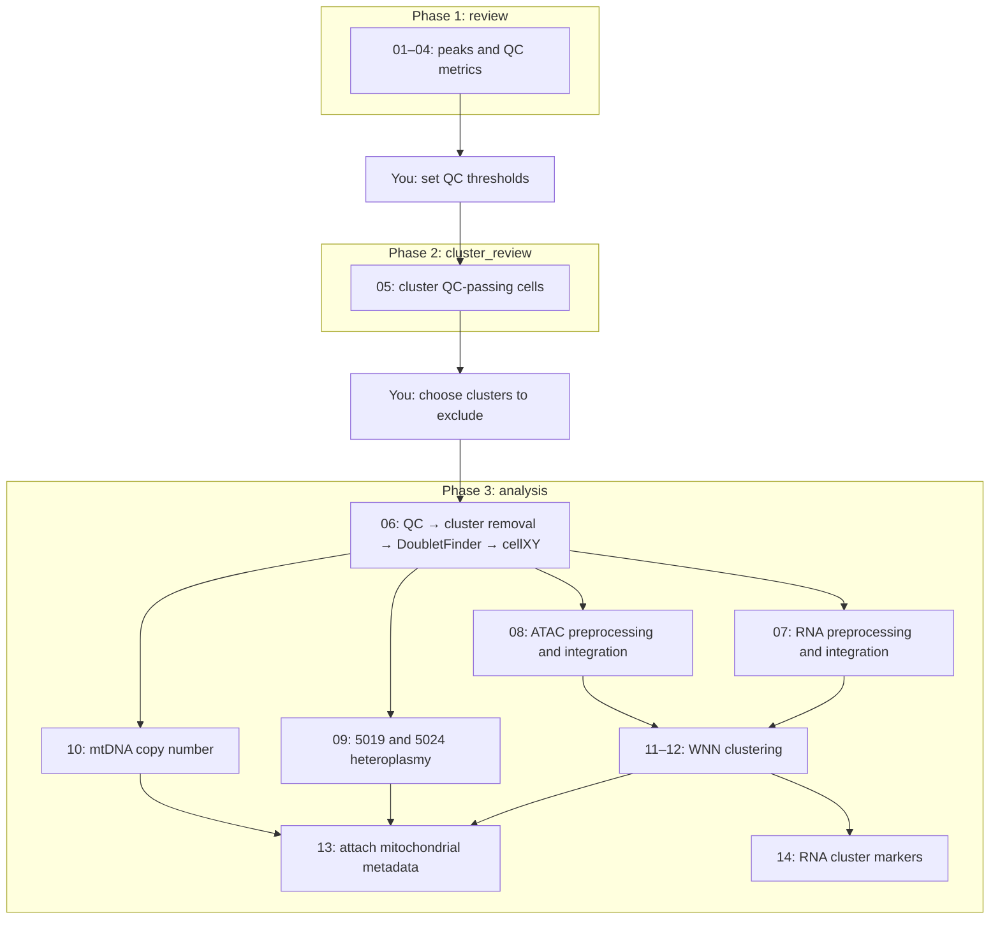

# Per-stage mouse embryo single-cell multiome workflow

This Nextflow workflow analyses mouse single-cell multiome data (RNA + ATAC, mm10), one developmental stage at a time. It performs comprehensive QC and preprocessing, integrates the RNA and ATAC modalities across samples, calculates mtDNA heteroplasmy and copy number for each cell, and identifies marker genes for each WNN cluster to support cell-type annotation.

## Requirements and inputs

### 1\. Software and packages

Download the pipeline from GitHub:

```bash
git clone https://github.com/YuelinYao/Stage_Multiome_Nextflow.git
cd Stage_Multiome_Nextflow
```

Use Nextflow with Java 17 or later. Load Java before installing or running Nextflow:

```bash
# Example (Cambridge MBU cluster)
module add java/17
curl -s https://get.nextflow.io | bash

# nextflow has been downloaded to
# /suffolk/WorkGenomicsD/yy605/software
# add the folder to your PATH
echo 'export PATH="/suffolk/WorkGenomicsD/yy605/software:$PATH"' >> ~/.bashrc
# Avoid home quota issues
export NXF_HOME=/suffolk/WorkGenomicsD/yy605/.nextflow
source ~/.bashrc
```

The installation command creates a `nextflow` executable in the current directory. Use `./nextflow` there, or place it in a directory on your `PATH` to use the `nextflow` commands below.

Use these existing environments when running this project:

| JSON parameter | Path |
| --- | --- |
| `conda_env` | `/suffolk/WorkGenomicsD/yy605/conda_env/stage_multiome` |
| `macs3_path` | `/suffolk/WorkGenomicsD/yy605/conda_env/macs3/bin/macs3` |

Enable the Conda profile with `-profile conda` for local execution or `-profile slurm,conda` for Slurm. Nextflow uses the R environment above for each task and calls MACS3 through its explicit executable path. Both paths must be accessible on every execution node. [site.config](site.config) is the only place where each process’s CPUs, memory and time limit are set (`main.nf` contains none), so always pass it, or your copy of it, with `-c`; without it, tasks get Nextflow’s defaults of one CPU and no memory request. Queue/account settings can be added there when required by your cluster.

Package versions for the existing `stage_multiome` Conda environment are recorded in [environment.yml](environment.yml). This is an exported Linux environment, including its dependencies and installation prefix. Packages installed from R rather than conda (DoubletFinder, cellXY, SCP, and JASPAR2020, TFBSTools, chromVAR and motifmatchr) are listed with their versions in its first line.

### 2\. Input files

#### Sample sheet (`samples.csv`)

The sample CSV lists one sample per row and must contain only `stage,sample_id,arc_out,mgatk_enriched_dir,mgatk_dir`; see [examples/samples.csv](examples/samples.csv). For example:

```csv
stage,sample_id,arc_out,mgatk_enriched_dir,mgatk_dir
E8.5,5019_Hi_1,/path/to/arc/outs,/path/to/mgatk_enriched/final,
```

Sample IDs must be unique within each stage, start with a letter or number, and contain only letters, numbers, `_`, `.` or `-`; `ALL_STAGE` is reserved for combined QC summaries. Sample IDs are workflow labels and do not need to match upstream Cell Ranger or mgatk run names. Sample-specific keys in the pipeline JSON must match these IDs. The `stage` set in the pipeline JSON selects which rows are analysed (see [Pipeline settings JSON](#pipeline-settings-json)).

#### What each path must contain

Use absolute paths that all execution nodes can read:

| Column | Required content |
| --- | --- |
| `arc_out` | Cell Ranger ARC `outs` directory containing `filtered_feature_bc_matrix.h5`, `atac_fragments.tsv.gz` and its `.tbi` index; analysis also requires `summary.csv` for detected-cell reporting and `atac_possorted_bam.bam` for step 10; `per_barcode_metrics.csv` supplies barcode translation when present |
| `mgatk_enriched_dir` | Required mgatk output used for step 09 and 10 heteroplasmy/depth and copy number metrics, readable by `Signac::ReadMGATK`, usually the `final` directory. |
| `mgatk_dir` | Ordinary mgatk output used automatically by step 10 for `mtDNA_CN_normalised`; may be blank, in which case this estimate remains `NA` |

Gene symbols, the reference genome and barcodes are requirements for the existing data, not additional files or CSV columns:

| Data requirement | Where it comes from |
| --- | --- |
| Mouse gene symbols | Gene names stored in ARC’s `filtered_feature_bc_matrix.h5`; cell-cycle scoring and sex inference require symbols rather than Ensembl IDs |
| mm10 reference | ARC and mgatk outputs must use a compatible mm10 reference; no reference FASTA is supplied to this workflow. The workflow supplies the rest:<br>• Step 01: standard mouse chromosomes (`species = "Mus musculus"`), mouse genome size `1.87e9` for MACS3 peak calling, and `Signac::blacklist_mm10` to remove problem regions from peaks<br>• Steps 03–08: gene annotation from `EnsDb.Mmusculus.v79`, for TSS enrichment and gene activity<br>• Step 06: cellXY mouse models (`genome = "Mm"`) for sex and male-female doublet prediction<br>• Step 08: `BSgenome.Mmusculus.UCSC.mm10` genome sequence for motif matching and chromVAR<br>• Step 09: mm10 chrM variant positions, checked against mgatk's reference alleles at the ten listed sites (including A at position 5019)<br>• Step 10: mouse autosomes chr1–chr19 and `Signac::blacklist_mm10` for the copy-number nuclear reference |
| Matching original 10x barcodes | Cell identifiers already stored in ARC and mgatk outputs; the workflow uses them to match mitochondrial measurements to retained cells. At least some retained cells must match; unmatched cells retain missing mgatk measurements |

## Overview of the pipeline

The workflow analyses one developmental stage at a time in three phases (`review`, `cluster_review` and `analysis`), each started as a separate run with `--phase`. Between phases you inspect the outputs and edit the pipeline JSON, so QC thresholds and low-quality clusters are chosen from your own data rather than fixed in advance. With `-resume`, each phase reuses the completed tasks of the previous one.

| Phase | Steps | What it does | What you do next |
| --- | --- | --- | --- |
| 1\. `review` | 01–04 | 01: call ATAC peaks per sample<br>02: merge them into one common peak set for the stage<br>03: calculate eight RNA/ATAC QC metrics per cell<br>04: summarise the metrics (MAD-based candidate bounds, violin plots)<br>No cells are removed. | Inspect `<outdir>/<stage>/qc/review/`, then set the QC `thresholds` (and any `sample_overrides`) in the JSON. |
| 2\. `cluster_review` | 05 | 05: apply your QC thresholds to each sample, cluster the QC-passing cells on RNA, and write per-cluster QC summaries, violin plots and marker genes.<br> | Inspect `<outdir>/<stage>/qc/cluster_review/`, then list low-quality cluster IDs per sample in `doublet.exclude_clusters` before removeing doublets (Step 06). |
| 3\. `analysis` | 06–14 | 06: remove QC-failing cells and the excluded clusters, then remove doublets with DoubletFinder and male-female doublets (adding sex information for cells) with cellXY; add sex predictions<br>07–08: preprocess RNA and ATAC per sample (scoring the cell cycle at the same time), then merge and integrate each modality across samples; add ATAC gene activity and chromVAR motif assays<br>09–10: measure 5019/5024 heteroplasmy and mtDNA copy number per cell<br>11–12: combine RNA and ATAC and build WNN clusters<br>13: attach the mitochondrial measurements to the WNN object<br>14: find RNA markers for each WNN cluster | Use `<outdir>/<stage>/objects/wnn_mgatk.rds` and the other published results. |


Steps 09 and 10 start for each sample as soon as it finishes step 06. RNA and ATAC preprocessing (07–08) start once all samples have finished step 06, and these branches run in parallel when the cluster has capacity. WNN (11–12) waits for both 07 and 08. Step 14 starts as soon as WNN is ready, while step 13 waits for WNN plus all mitochondrial tables.

## Pipeline settings JSON

Supply this file through `-params-file` (see the [Nextflow parameter-file documentation](https://docs.seqera.io/nextflow/reference/cli/run#-params-file)). It contains both run parameters and analysis sections at the top level. The sections below follow the workflow order; JSON key order itself does not affect execution. See [examples/pipeline\_settings.example.json](examples/pipeline_settings.example.json) for the complete structure. Its QC thresholds are illustrative and must be reviewed for your samples.

Section and parameter names are case-sensitive. Unknown parameters/sections, invalid sample-specific settings and sample IDs absent from the sample sheet are rejected. Use unique JSON keys.

| JSON section | Parameters | Script that uses them |
| --- | --- | --- |
| Run parameters | `samples`, `stage`, `outdir`, `macs3_path`, `conda_env` | `main.nf`; `nextflow.config` uses `conda_env`, and `outdir`/`stage` for the `work/` and `reports/` folders |
| `note` | Optional free text, for your own record | Not used by the analysis |
| `peaks` | `peak_min`, `peak_max` | `02_consensus_peaks.R` |
| `thresholds` | `min`, `max` for each of the eight QC metrics | `05_review_clusters.R`, `06_qc_doubletfinder.R` |
| `sample_overrides` | Per-sample `min`, `max` for selected QC metrics | `05_review_clusters.R`, `06_qc_doubletfinder.R` |
| `review_QC_cluster` | `RNA_dims`, `algorithm`, `resolution` | `05_review_clusters.R` |
| `doublet` | `PC_dims`, `algorithm`, `resolution`, `exclude_clusters`, `remove_mf_doublets`; optional `expected_rate`, `sample_rates` | `06_qc_doubletfinder.R` |
| `RNA_processing` | `RNA_dims`, `RNA_umap_dims`, `algorithm`, `resolution`, `integrate_rna` | `07_preprocess_rna.R` |
| `ATAC_processing` | `ATAC_dims`, `ATAC_integrate_dims`, `algorithm`, `resolution`, `integrate_atac`, `min_cutoff` | `08_preprocess_atac.R` |
| `copy_number` | `bin_size`, `quantile`, `mapq`, `baseq`, `ploidy`, `min_nuclear_bases`, `min_mt_depth`, `keep_duplicates`, `reference_bed`, `blacklist` | `10_estimate_mtdna_copy_number.R` |
| `WNN` | `RNA_dims`, `ATAC_dims`, `algorithm`, `resolution`, `plot_point_size`, `lineage_assay`, `lineage_markers` | `12_wnn_stage.R` |

The `algorithm` key uses Seurat’s clustering algorithm codes in every analysis section:

| Value | Clustering algorithm |
| --- | --- |
| `1` | Louvain |
| `2` | Louvain with multilevel refinement |
| `3` | SLM (Smart Local Moving) |
| `4` | Leiden |

The configuration defaults to `3`. See [Seurat `FindClusters`](https://satijalab.org/seurat/reference/findclusters) for the algorithm definitions.

### Run parameters ###
Set these in the same JSON, before the analysis sections:

```json
"samples": "/suffolk/WorkGenomicsD/yy605/Stage_Multiome_Nextflow/examples/samples.csv",
"stage": "E8.5",
"outdir": "/suffolk/WorkGenomicsD/yy605/stage_results",
"macs3_path": "/suffolk/WorkGenomicsD/yy605/conda_env/macs3/bin/macs3",
"conda_env": "/suffolk/WorkGenomicsD/yy605/conda_env/stage_multiome"
```

`stage` selects every sample-sheet row with that label, for example all WT and mutant rows labelled `E8.5`, and excludes other stages; matching is case-sensitive and the workflow stops if no rows match. 

`outdir` is the output root, best kept outside the pipeline repository; stage results, Nextflow task directories (`work/`) and execution reports (`reports/`) all go under `<outdir>/<stage>/`. Keep `samples`, `stage`, `outdir` and peak limits consistent across phases. See [Output files and directory structure](#output-files-and-directory-structure) for where each file is written.

`macs3_path` must be the absolute MACS3 executable path, and `conda_env` the existing environment path used by the Conda profile.

### Analysis parameters ###

**1\. `peaks`: common peak widths.** Used from the initial review phase, before QC metrics are calculated. Both width boundaries are excluded. Omitted settings default to 20 and 10,000 bp.

```json
"peaks": {
  "peak_min": 20,
  "peak_max": 10000
}
```

**2\. `thresholds`: shared cell QC limits.** After reviewing the distributions, edit `min` and `max` for all eight metrics in your pipeline JSON. Each metric needs at least one numeric bound; `null` disables one side. Cells must pass all eight metrics, bounds are inclusive, and non-finite values fail QC. These thresholds are applied before clustering in 05 and again in 06. For example, one metric entry is:

```json
"nCount_RNA": {"min": 1000, "max": 40000}
```

This entry belongs inside `thresholds` and keeps cells with 1,000–40,000 RNA counts, including both endpoints. Shared limits apply to every sample unless overridden below. Use `min` to require a minimum value and `max` to reject values above an upper limit; for example, `"percent.mt": {"min": null, "max": 10}` keeps cells with at most 10% mitochondrial RNA. Include both keys even when one is `null`; they cannot both be `null`. The complete example lists all eight required metrics.

**3\. `sample_overrides`: optional sample-specific QC limits.** For each listed metric, both sample-specific bounds replace the shared bounds. Unlisted metrics retain their shared limits. Overrides may be stricter or more permissive; choose them from the sample’s QC distributions. Keys must match CSV `sample_id` values for the selected stage. Leave this section as `{}` for shared thresholds only.

```json
"sample_overrides": {
  "5019_Hi_1": {"nCount_RNA": {"min": 1200, "max": 35000}}
}
```

With the shared RNA count limits above, `5019_Hi_1` instead keeps cells with 1,200–35,000 RNA counts; its other seven metrics still use `thresholds`. All other samples keep the shared 1,000–40,000 range. Setting an override bound to `null` removes that side’s limit for that sample; it does not inherit the shared bound.

**4\. `review_QC_cluster`: per-sample cluster review in 05.** These settings apply after cell QC, before you choose clusters to remove. `RNA_dims` selects PCs for neighbours and clustering. `resolution` controls cluster granularity.

```json
"review_QC_cluster": {
  "RNA_dims": "1:20",
  "algorithm": 3,
  "resolution": 2
}
```

**5\. `doublet`: reviewed-cluster removal and DoubletFinder in 06.** This step removes the listed 05 cluster IDs, then uses its own algorithm and resolution for homotypic-correction clustering as a part of doublet correction. `PC_dims` controls neighbours, clustering, the pK sweep, DoubletFinder and UMAP. The range of PCA must start at PC1 and end at or below PC50. Cluster IDs below are examples only; use `{}` when none should be removed.

```json
"doublet": {
  "PC_dims": "1:20",
  "algorithm": 3,
  "resolution": 2,
  "exclude_clusters": {"5019_Hi_1": ["3", "7"]},
  "remove_mf_doublets": true
}
```

`remove_mf_doublets` (default `true`) removes the cellXY male-female doublets (`CellXY_db == "Doublet"`) after DoubletFinder; set it to `false` to keep them flagged only.

By default, the expected rate is estimated from ARC’s detected-cell count using `nextgem_multiome_doublet_rate()`. The expected doublet count is adjusted for homotypic doublets. `expected_rate` (default `"auto"`) and `sample_rates` (default `{}`) are optional overrides: a number between 0 and 1 replaces the ARC-based estimate for all samples or for the samples named in `sample_rates`, for example `"sample_rates": {"5019_Hi_1": 0.05}`. Omit both to use ARC-based estimation. See Step 06 for the Next GEM Multiome assumption and supported count range.

**6\. `RNA_processing`: RNA analysis in 07.** `RNA_dims` controls per-sample and stage RNA neighbours/clustering and CCA anchors. `RNA_umap_dims` controls both stage RNA UMAPs. These clusters use this section’s algorithm and resolution. `integrate_rna` enables CCA integration between samples; it requires at least two samples. Set it to `false` for a single-sample stage.

```json
"RNA_processing": {
  "RNA_dims": "1:20",
  "RNA_umap_dims": "1:50",
  "algorithm": 3,
  "resolution": 2,
  "integrate_rna": true
}
```

**7\. `ATAC_processing`: ATAC analysis in 08.** `ATAC_dims` controls neighbours, clustering, UMAP and reciprocal-LSI anchors. `ATAC_integrate_dims` selects components corrected during integration. The [Signac integration tutorial](https://stuartlab.org/signac/articles/integrate_atac#integration) uses `dims = 2:30` for anchors, `dims.to.integrate = 1:30` for correction, and `dims = 2:30` for the integrated UMAP, so component 1 is retained in the corrected reduction but excluded from anchors, neighbours, clustering, UMAP and WNN by the default analysis ranges.

`min_cutoff = "q5"` selects peaks above the 5th percentile of total counts for LSI (approximately the top 95%; tied counts can affect the proportion), retaining all peaks in the raw assay. This cutoff is applied separately to each sample and again to the merged stage object. The pipeline accepts percentile strings from `"q0"` to below `"q100"`, or nonnegative integer count thresholds; `10`, for example, selects peaks with more than 10 total counts. See [Signac `FindTopFeatures`](https://stuartlab.org/signac/reference/findtopfeatures). Set `integrate_atac` to `false` for a single-sample stage.

```json
"ATAC_processing": {
  "ATAC_dims": "2:40",
  "ATAC_integrate_dims": "1:40",
  "algorithm": 3,
  "resolution": 2,
  "integrate_atac": true,
  "min_cutoff": "q5"
}
```

**8\. `copy_number`: per-sample mtDNA copy-number estimation in 10.** `bin_size` and `quantile` control nuclear reference selection; `mapq`, `baseq` and `keep_duplicates` control BAM counting. `ploidy` supplies the nuclear copy-number assumption. `min_nuclear_bases` and `min_mt_depth` flag low coverage: a cell with fewer nuclear bases, or with mean mtDNA depth below `min_mt_depth`, receives a non-`pass` `qc_status` and an `NA` normalised estimate, while its `_raw` estimate is kept. `mapq` and `baseq` filter only the nuclear reads counted from the ARC BAM; mitochondrial depth comes from mgatk’s depth table.

```json
"copy_number": {
  "bin_size": 500,
  "quantile": 0.985,
  "mapq": 30,
  "baseq": 20,
  "ploidy": 2,
  "min_nuclear_bases": 1000,
  "min_mt_depth": 5,
  "keep_duplicates": false,
  "reference_bed": null,
  "blacklist": null
}
```

With `reference_bed: null`, each sample selects nuclear intervals from its ARC fragments. Set `reference_bed` to an absolute shared BED path to use the same intervals for every sample. `blacklist: null` uses Signac’s bundled mm10 blacklist during reference selection; an absolute BED path overrides it. A supplied reference BED is used as-is and must already exclude blacklist regions.

**9\. `WNN`: combined RNA/ATAC analysis in 12.** Its own `RNA_dims` and `ATAC_dims` select components for multimodal neighbours; its algorithm and resolution control final `wsnn` clusters. WNN uses integrated reductions when the respective RNA/ATAC integration switch is enabled.

```json
"WNN": {
  "RNA_dims": "1:20",
  "ATAC_dims": "2:40",
  "algorithm": 3,
  "resolution": 2,
  "plot_point_size": 0.1,
  "lineage_assay": "SCT",
  "lineage_markers": ["Pou3f1", "Foxa1", "Pdgfra"]
}
```

`WNN.plot_point_size` controls cell points in both PDFs. `lineage_assay` selects normalized expression for the blended lineage plot (default `SCT`, `data` slot); `lineage_markers` contains the mouse gene symbols to display. These settings are used only by `12_wnn_stage.R`.

Each analysis section has independent defaults matching the examples above; changing one section does not change another section’s clustering settings.

## Output files and directory structure

Published results are organised under `<outdir>/<stage>/`. For example, `"outdir": "stage_results"` and `"stage": "E8.5"` in your parameter file create the structure below after completing all three phases. `<sample>` is the `sample_id` from your CSV, and per-sample files are repeated for each selected sample. Nextflow task work directories are kept in `<outdir>/<stage>/work/`, and one execution trace, report and timeline per phase in `<outdir>/<stage>/reports/`.

```text
stage_results/
└── E8.5/
    ├── peaks/
    │   ├── sample/
    │   │   └── <sample>.bed
    │   └── common_peaks.bed
    ├── qc/
    │   ├── review/
    │   │   ├── all_cells_qc_metrics.tsv
    │   │   ├── qc_summary.tsv
    │   │   ├── qc_mad_candidates.tsv
    │   │   └── stage_qc_distributions.pdf
    │   ├── cluster_review/
    │   │   ├── <sample>.cluster_cells.tsv
    │   │   ├── <sample>.cluster_summary.tsv
    │   │   ├── <sample>.cluster_qc.pdf
    │   │   └── <sample>.cluster_markers.tsv
    │   └── filtered/
    │       ├── <sample>.qc.tsv
    │       └── <sample>_Doublet.pdf
    ├── mgatk/
    │   └── <sample>.mtDNA.tsv
    ├── copy_number/
    │   ├── <sample>.mtDNA_copy_number.tsv
    │   ├── <sample>.nuclear_reference.bed
    │   └── <sample>.settings.txt
    ├── plots/
    │   ├── wnn_clusters_umap.pdf
    │   └── Cell_lineage_umap.pdf
    ├── objects/
    │   ├── rna_unintegrated.rds
    │   ├── rna_integrated.rds         # only when integrate_rna = true
    │   ├── rna_cell_annotations.tsv
    │   ├── atac_unintegrated.rds
    │   ├── atac_integrated.rds        # only when integrate_atac = true
    │   ├── wnn.rds
    │   ├── wnn_mgatk.rds
    │   └── all_cells_mtDNA.tsv
    ├── deg/
    │   ├── cluster_markers.tsv
    │   └── per_cluster/
    │       └── cluster_<id>_markers.tsv   # one per WNN cluster
    ├── reports/                       # one set per phase: review, cluster_review, analysis
    │   ├── execution_report_<phase>.html
    │   ├── execution_timeline_<phase>.html
    │   └── execution_trace_<phase>.txt
    └── work/                          # Nextflow task directories (intermediate files, logs)
```

| Files or directory | Contents and use |
| --- | --- |
| `peaks/sample/<sample>.bed` | Peaks called separately for each sample |
| `peaks/common_peaks.bed` | Stage-level common intervals used to recount ATAC fragments |
| `qc/review/` | Per-cell QC metrics before filtering, distribution plots, sample/stage summaries, MAD candidates |
| `qc/cluster_review/<sample>.cluster_cells.tsv` | QC-passing barcodes with the exact reviewed cluster assignments used for cluster removal in doublet correction analysis |
| Other `qc/cluster_review/` files | Cluster QC summaries, plots and significant positive RNA markers for manual review |
| `qc/filtered/<sample>.qc.tsv` | One summary row per sample: initial, QC-passing, cluster-retained and singlet cell counts, plus DoubletFinder settings/results |
| `qc/filtered/<sample>_Doublet.pdf` | RNA UMAP showing singlet/doublet classifications before doublet removal |
| `mgatk/<sample>.mtDNA.tsv` | Per-cell mitochondrial depth, counts and individual/pooled 5019- and 5024-panel heteroplasmy for retained singlets |
| `copy_number/` | Step 10 per-cell estimates, selected nuclear BED and settings/provenance for each sample |
| `objects/rna_*.rds`, `objects/atac_*.rds` | Stage Seurat objects before/after integration; WNN reads the integrated file when its integration switch is enabled, otherwise the unintegrated file |
| `objects/rna_cell_annotations.tsv` | Per-cell sample ID, cell-cycle scores/phase and sex prediction |
| `objects/wnn.rds` | Combined RNA/ATAC object with modality reductions, WNN UMAP, modality weights and WNN clusters, plus the `chromvar`, `chromvar_rename` and `gene.activities` assays |
| `objects/wnn_mgatk.rds` | Final combined object, including heteroplasmy and copy-number estimates in cell metadata; use this for further analysis |
| `objects/all_cells_mtDNA.tsv` | All samples’ mitochondrial measurements, ordered to match the final WNN object’s cells |
| `plots/wnn_clusters_umap.pdf` | WNN UMAPs coloured by `sample_id` and labelled `wsnn_clusters` |
| `plots/Cell_lineage_umap.pdf` | Blended normalized lineage-marker expression on the WNN UMAP |
| `deg/cluster_markers.tsv` | Positive RNA markers for WNN clusters, filtered to finite adjusted p-values below 0.05 |
| `deg/per_cluster/cluster_<id>_markers.tsv` | The same markers split into one file per WNN cluster; header-only when a cluster has no significant markers |

The `review` phase produces `peaks/` and `qc/review/`. The `cluster_review` phase adds `qc/cluster_review/`. The `analysis` phase reads the saved cluster-review tables and adds `qc/filtered/`, `mgatk/`, `copy_number/`, `objects/` and `deg/`; upstream peak/QC tasks are reused with `-resume` when unchanged. Integrated RDS files are produced only when the corresponding integration switch is enabled. Each distinct RNA/ATAC analysis object is saved once; WNN uses `rna_integrated.rds` or `rna_unintegrated.rds` and `atac_integrated.rds` or `atac_unintegrated.rds` according to those switches.

The per-sample `<sample>.rna.qc.rds` and `<sample>.atac.qc.rds` checkpoints remain in the `QC_FILTER_DOUBLET` task directory under `<outdir>/<stage>/work/`; they are not copied into the published results. Task logs (`.command.log`, `.command.err`, `.command.out`) are also under `work/`, while `.nextflow.log` is in the launch directory. Keep `work/` and `.nextflow/` when resuming runs. ATAC-containing RDS objects refer to the original fragment files, so those shared input paths must remain accessible when using fragment-based Signac functions later.

## Vignette: example test run

**Before you start:** copy two files from the repository to your own location and edit the copies: [examples/pipeline\_settings.example.json](examples/pipeline_settings.example.json) (paths and analysis settings) and [site.config](site.config) (CPUs, memory, time limits and any Slurm queue/account). Use the same two files for all three phases. Editing them inside the repository would conflict with `git pull`. The commands below use the repository paths; replace `-params-file` and `-c` with your copies.


**Where to launch:** `-resume` continues the most recent run recorded in the launch directory’s `.nextflow/` folder, so start every phase of a stage from the same directory. When processing several stages side by side, launch each stage from its own directory, using absolute paths for `main.nf`, `site.config` and the JSON.

```bash
mkdir test_run
cd test_run
cp /suffolk/WorkGenomicsD/yy605/Stage_Multiome_Nextflow/examples/pipeline_settings.example.json .
cp /suffolk/WorkGenomicsD/yy605/Stage_Multiome_Nextflow/site.config .
```

This example runs all three phases on the three test samples in [examples/samples\_test.csv](examples/samples_test.csv) (stage E8.5), using copies of the example settings. The output folder is set by `outdir` inside `pipeline_settings.example.json`, not on the command line. The example points to an existing location:

```json
"outdir": "/suffolk/WorkGenomicsD/yy605/stage_results_test",
```

Run all three phases from inside `test_run`, so `-resume` can reuse earlier tasks.


### Phase 1: review

Run `--phase review` to calculate raw QC distributions (step 01-04). This phase uses the `peaks` settings and does not apply QC thresholds.

```bash
NXF_VER=25.10.8 nextflow run /suffolk/WorkGenomicsD/yy605/Stage_Multiome_Nextflow/main.nf \
  -params-file pipeline_settings.example.json \
  --phase review \
  -profile slurm,conda -c site.config
```
Inspect `<outdir>/E8.5/qc/review/` and adjust `thresholds` in `pipeline_settings.example.json` if needed. Keep peak limits unchanged across all phases; changing them requires rerunning review and cluster review.

### Phase 2: cluster review

Run `--phase cluster_review` to cluster the QC-passing cells of each sample (step 05):

```bash
NXF_VER=25.10.8 nextflow run /suffolk/WorkGenomicsD/yy605/Stage_Multiome_Nextflow/main.nf \
  -params-file pipeline_settings.example.json \
  --phase cluster_review \
  -profile slurm,conda -c site.config -resume
```
Then inspect `<outdir>/E8.5/qc/cluster_review/`: per-cell cluster assignments, cluster-level QC summaries, violin plots and RNA markers. Add any low-quality cluster IDs to `doublet.exclude_clusters` for the corresponding sample. Empty exclusions mean no additional cluster removal; the workflow does not automatically identify low-quality biological populations. If QC thresholds, `review_QC_cluster` settings, input data, seeds or package versions change, rerun cluster review because cluster IDs may change.

### Phase 3: analysis

Run `--phase analysis` once you have added the low-quality cluster IDs to `doublet.exclude_clusters` (steps 06–14).


```bash
NXF_VER=25.10.8 nextflow run /suffolk/WorkGenomicsD/yy605/Stage_Multiome_Nextflow/main.nf \
  -params-file pipeline_settings.example.json \
  --phase analysis \
  -profile slurm,conda -c site.config -resume
```
The final object is `<outdir>/E8.5/objects/wnn_mgatk.rds`; DEGs for cell-type annotation are in `<outdir>/E8.5/deg`; run times and resource use are in `<outdir>/E8.5/reports/`. 

Do not change the QC `thresholds`, `sample_overrides` or `review_QC_cluster` settings between cluster review and analysis. If you need different QC settings, rerun `--phase cluster_review`, inspect the new clusters (their IDs may change), update `doublet.exclude_clusters`, then run analysis.


## Details for each step

### Step 01: call ATAC peaks per sample

Related tutorial: [Signac 1.2.0 multiome peak-calling tutorial](https://stuartlab.org/signac/1.2.0/articles/pbmc_multiomic#peak-calling-1).

`01_peaks.R` reads ARC filtered-cell peaks and fragments, builds a ChromatinAssay and calls peaks with MACS3 through Signac. It uses `GenomeInfoDb::keepStandardChromosomes(species = "Mus musculus", pruning.mode = "coarse")` to retain standard mouse chromosomes. It then removes entire peaks overlapping `Signac::blacklist_mm10` using `GenomicRanges::subsetByOverlaps(invert = TRUE)` before exporting the BED. Note: when `chrM` is listed under `non_nuclear_contigs` in the reference used for the run, Cell Ranger ARC excludes mitochondrial fragments from the ATAC fragments file while retaining mitochondrial alignments in the ATAC BAM for analysis with mgatk. The effective mouse genome size is `1.87e9`.

Outputs: `STAGE/peaks/sample/<sample>.bed`. This uses all fragments belonging to the ARC filtered-cell barcodes, before the reviewed QC thresholds.

### Step 02: create a stage-level common peak set

`02_consensus_peaks.R` combines the peak BED files from all selected samples within the stage. It uses `GenomicRanges::reduce` to merge overlapping or adjacent intervals into a union, then filters the widths of those merged intervals. This follows the [Signac merging procedure](https://stuartlab.org/signac/articles/merging).

Peak width limits are controlled by the `peaks` section of the pipeline JSON supplied through `-params-file`:

```json
"peaks": {
  "peak_min": 20,
  "peak_max": 10000
}
```

This retains merged intervals with width strictly greater than 20 bp and strictly less than 10,000 bp; both boundaries are excluded. These are also the defaults when the settings are omitted. Use the same peak limits for review, cluster review and analysis. If you change them, rerun review and cluster review because the common peak set, ATAC counts and QC-passing cells may change.

Output: `<outdir>/<stage>/peaks/common_peaks.bed`. 

### Step 03–04: review the eight RNA/ATAC QC metrics
Related tutorial: [Signac 1.2.0 Joint RNA and ATAC analysis: 10x multiomic tutorial](https://stuartlab.org/signac/1.2.0/articles/pbmc_multiomic).

`03_qc_metrics.R` creates RNA and common-peak ATAC objects for cells shared between modalities. It calculates the following metrics before applying user thresholds:

| Modality | Metric in files/JSON | Meaning |
| --- | --- | --- |
| RNA | `nCount_RNA` | Total RNA UMI counts |
| RNA | `nFeature_RNA` | Number of detected RNA genes |
| RNA | `percent.mt` | RNA percentage from genes matching `^[Mm][Tt]-` |
| RNA | `percent.ribo` | RNA percentage from genes matching `^Rp[ls]` |
| ATAC | `nCount_ATAC` | Counts summed over the recounted common peaks |
| ATAC | `nFeature_ATAC` | Number of detected common peaks |
| ATAC | `nucleosome_signal` | Signac fragment-length nucleosome signal |
| ATAC | `TSS.enrichment` | Signac TSS enrichment using mm10 annotation |

Per-sample `<sample>.metrics.tsv` tables remain internal files in the Nextflow work directory and are combined into `all_cells_qc_metrics.tsv`. Published review outputs are saved under `<outdir>/<stage>/qc/review/`.

QC violin plots use the shared `plot_qc_violins()` function in [scripts/00\_common.R](scripts/00_common.R), with all eight metrics on one page in two rows and four columns. Edit this function to change the theme or font sizes for stage-level and cluster-review QC plots.

Categorical plots use the supplied 100-colour `plot_palette` in `scripts/00_common.R`, preserving its order and repeated entries. `plot_group_colors()` assigns colours in group order and repeats the palette for more than 100 groups. QC violins keep the same group colours across all eight panels; DoubletFinder UMAP plots use grey (`#808080`) for Singlet and red (`#ff0000`) for Doublet. Edit `plot_palette` to change these colours.

`04_qc_review.R` validates and combines the sample tables in sample-ID order, then writes:

| Output | Content |
| --- | --- |
| `all_cells_qc_metrics.tsv` | Combined per-cell measurements from all `<sample>.metrics.tsv` files in the selected stage; no additional per-cell metrics are calculated |
| `qc_summary.tsv` | One row per sample/metric, plus pooled `ALL_STAGE`: n, mean, SD, min, quantiles, median, max, scaled MAD and 3/5/7-MAD bounds |
| `qc_mad_candidates.tsv` | One row per sample/metric/multiplier with lower and upper bounds |
| `stage_qc_distributions.pdf` | One page comparing samples across eight metrics (2 rows × 4 columns) |

Run `Rscript tests/qc_review.R` to check table combination, QC summaries, MAD bounds, plotting and preservation of your supplied JSON with synthetic data.

For k = 3, 5 or 7, bounds are `median ± k × mad(x, constant = 1.4826)` and appear as `mad_k_lower`/`mad_k_upper` in the summary. Non-finite values are excluded from statistics. Bounds are not clipped to zero and are not automatically applied. Zero MAD gives equal lower/upper bounds; inspect the distribution before choosing thresholds. Note that The `1.4826` constant is a scaling factor. Under a perfectly normal (Gaussian) distribution, multiplying the raw MAD by `1.4826` makes it exactly equal to the standard deviation.

### Step 05: review low-quality clusters before DoubletFinder

`05_review_clusters.R`, run with `--phase cluster_review`, applies the reviewed eight-metric QC thresholds to each sample. It then log-normalizes RNA, selects 2,000 variable genes, scales, computes individual PCA, finds neighbours with `review_QC_cluster.RNA_dims`, and clusters with that section’s algorithm/resolution. The saved `<sample>.cluster_cells.tsv` contains the barcode-to-cluster assignments that step `06` uses for cluster removal.

The shared `preprocess_qc_rna` helper in `scripts/00_common.R` explicitly uses seed `123` for R, PCA and clustering in steps 05 and 06. 

Outputs in `STAGE/qc/cluster_review/`: `<sample>.cluster_cells.tsv`, `<sample>.cluster_summary.tsv`, `<sample>.cluster_qc.pdf`, and `<sample>.cluster_markers.tsv`. Marker tables retain only rows with finite `p_val_adj < 0.05`. Review RNA counts, mitochondrial percentages and marker informativeness together. Enter unwanted cluster IDs as strings in `doublet.exclude_clusters` (Optional). This provides the manual review/removal route described by the [DoubletFinder authors](https://github.com/chris-mcginnis-ucsf/DoubletFinder#best-practices-for-scrna-seq-data-generated-without-sample-multiplexing). For a related example of reviewing QC metrics by cluster, removing low-quality clusters and repeating preprocessing, see the [snRNA-seq Guide: cluster QC](https://lahuuki.github.io/rstats/2026-03-19-snRNAseqGuide/index.html).

### Step 06: joint QC, cluster removal, DoubletFinder and cellXY

Step 06 also writes an internal `<sample>.singlet_barcodes.tsv` with `sample_id` and original `barcode` columns. Step 10 consumes it directly, allowing copy-number estimation to start alongside step 09. This table stays in the Nextflow work directory.

`06_qc_doubletfinder.R` applies all eight QC thresholds and reads the saved `<sample>.cluster_cells.tsv` from step 05. It validates the sample ID, unique barcodes, cluster labels, QC-passing cell set and QC measurements, aligns labels by barcode, and removes the listed clusters without repeating the preliminary clustering. It then computes normalization, variable features, PCA, neighbours and clusters on the retained cells before running DoubletFinder. Unknown exclusion IDs, mismatched cells and changed QC measurements fail explicitly; rerun cluster review when inputs or QC decisions change. Cluster removal reads `reviewed_qc_cluster` directly. These original reviewed labels remain in the RNA metadata; `pre_doublet_clusters` is created only by the subsequent reclustering for DoubletFinder’s homotypic correction. The two columns represent separate clustering steps, although their assignments can coincide when the retained cells and settings produce the same partition. At least 100 cells must remain before DoubletFinder.

DoubletFinder runs separately on each sample, using log-normalized RNA. After reviewed-cluster removal, step 06 uses [Seurat’s default `RunPCA()` setting](https://satijalab.org/seurat/reference/runpca) of 50 computed PCs and uses `doublet.PC_dims` (default PC1–PC20) for neighbours, clustering, the pK sweep and DoubletFinder. Its homotypic-correction clustering uses `doublet.algorithm` and `doublet.resolution`. A pN/pK sweep selects the pK with maximum BCmetric. 

By default, leave `expected_rate` as `"auto"` and `sample_rates` empty (or omit both). Step 06 then reads `Estimated number of cells` from each ARC `outs/summary.csv` and passes it to `nextgem_multiome_doublet_rate()`, which linearly interpolates the recovered-nuclei multiplet-rate table in the [Next GEM Multiome guide, page 22](https://cdn.10xgenomics.com/image/upload/v1666737555/support-documents/CG000338_ChromiumNextGEM_Multiome_ATAC_GEX_User_Guide_RevF.pdf#page=22). Samples outside 500–10,000 cells stop with an error and need an explicit rate in `expected_rate` or `sample_rates`. The expected doublet count is calculated as `n_exp = max(1, round(cluster_pass × expected_rate × (1 − homotypic_proportion)))`. The report records `arc_detected_cells`, `rate_source`, `expected_rate`, `homotypic_proportion`, `expected_doublets_unadjusted` and the adjusted `expected_doublets`. The rate is based on the cells recovered before QC but applied to the cells remaining after QC and cluster removal.

After DoubletFinder, step 06 runs cellXY (`annotate_cellxy()`) on the DoubletFinder singlets of each sample:

-   `cellXY::classifySex(counts, genome = "Mm", qc = FALSE)`: stored as `sex_prediction`. The cells already passed pipeline QC; uncertain predictions remain missing. These are expression-based predictions, not sample sex assignments. cellXY internally converts counts to a dense matrix, so large samples may require substantial RAM.
-   `cellXY::findMfDoublet(counts, genome = "Mm")`: stored as `CellXY_db` (`Singlet` or `Doublet`). It flags male-female doublets, droplets combining cells that express female (Xist) and male (chrY) genes. With `doublet.remove_mf_doublets: true` (default) these cells are removed in step 06; with `false` they are only flagged. With removal enabled, all remaining cells are `Singlet`; the numbers flagged and removed are recorded in `<sample>.qc.tsv`.

Male-female doublets are invisible to DoubletFinder when both cells are of the same type, so the two methods complement each other. They are removed after DoubletFinder rather than before, because DoubletFinder’s expected doublet count already includes them. The number flagged and removed is recorded in the report.

The resulting singlet barcodes select both RNA and ATAC. Cell names gain the sample prefix; metadata retains `sample_id` and the original `barcode` for mgatk matching. Outputs are individual `<sample>.rna.qc.rds` and `<sample>.atac.qc.rds` checkpoints in the Nextflow work directory, and a published `<sample>.qc.tsv` recording raw/QC/cluster/singlet counts, excluded cluster IDs, pK, rate and expected doublets.

Before selecting singlets, step 06 computes RNA UMAP using `doublet.PC_dims` and saves `<outdir>/<stage>/qc/filtered/<sample>_Doublet.pdf`, showing both singlets and doublets. The plot uses `theme_bw()`, a centered sample title, and a 6 × 5 inch page. Singlet RNA checkpoints retain the `DoubletFinder` classification metadata.

Cell counts are reported per sample in `<outdir>/<stage>/qc/filtered/<sample>.qc.tsv` and in the task’s `.command.err` log. `raw_joint` is the number of starting cells with both modalities. Each removal count is relative to the immediately preceding step; if no clusters are excluded, `cluster_removed` is zero.

| Step | Cells remaining | Cells removed |
| --- | --- | --- |
| Starting total: cells with both RNA and ATAC | `raw_joint` | — |
| 1\. Initial QC metric filtering | `qc_pass` | `qc_removed` |
| 2\. Reviewed-cluster removal, before reclustering | `cluster_pass` | `cluster_removed` |
| 3\. DoubletFinder singlet selection | `df_singlets` | `df_removed` |
| 4\. cellXY male-female doublet removal (`doublet.remove_mf_doublets`) | `final_singlets` | `mf_doublets_removed` (of `mf_doublets_flagged`) |

### Step 07: individual RNA preprocessing, then stage merge and integration

`07_preprocess_rna.R` uses its task-specific `RNA_processing` settings JSON and all filtered RNA RDS files for the stage. For each sample, it performs log-normalization, 2,000-variable-gene selection, scaling, individual PCA, neighbours and sample clustering. `sex_prediction` and `CellXY_db` from step 06 are carried in each sample’s metadata. It then adds:

-   `CellCycleScoring`: `S.Score`, `G2M.Score` and `Phase`, using case-insensitive matches of Seurat’s 2019 marker panel to observed mouse symbols.
-   SCT v2 normalization with 2,000 variable features per sample.

After individual processing it selects shared SCT integration features, prepares SCT residuals, and merges samples. It computes `rna_merged_pca` on SCT features, and creates `rna_unintegrated_clusters` and `rna_unintegrated_umap`. When enabled, SCT CCA `IntegrateLayers` creates `integrated.cca`, followed by `rna_integrated_clusters`, `rna_integrated_umap`, and `PrepSCTFindMarkers`. See [Seurat CCA integration](https://satijalab.org/seurat/reference/ccaintegration).

Published outputs: `rna_unintegrated.rds`, optional `rna_integrated.rds`, and `rna_cell_annotations.tsv` containing per-cell sample, cycle scores/phase, sex prediction and male-female doublet prediction (`CellXY_db`). No individual preprocessed RDS files are saved.

### Step 08: individual ATAC preprocessing, then stage merge and integration

`08_preprocess_atac.R` uses its task-specific `ATAC_processing` settings JSON and all filtered ATAC RDS files. When integration is enabled, it runs sample-level `FindTopFeatures`, TF-IDF and SVD/LSI in memory up to the largest `ATAC_processing.ATAC_dims` component for reciprocal-LSI anchors. Sample-level LSI is skipped when integration is disabled. It merges the objects while retaining fragment mappings, then recomputes stage TF-IDF/LSI and generates `atac_unintegrated_clusters` and `atac_unintegrated_umap`.

When enabled, `FindIntegrationAnchors(reduction = "rlsi")` and `IntegrateEmbeddings` create `integrated_lsi`, followed by `atac_integrated_clusters` and `atac_integrated_umap`. This follows the [Signac ATAC integration workflow](https://stuartlab.org/signac/articles/integrate_atac.html).

After the stage TF-IDF/LSI, step 08 adds three assays to the merged ATAC object, following the official Signac tutorials: [motif analysis](https://github.com/stuart-lab/signac/blob/1.14.0/vignettes/motif_vignette.Rmd) (`getMatrixSet`, `AddMotifs`, `RunChromVAR`) and the [PBMC gene activity section](https://github.com/stuart-lab/signac/blob/1.14.0/vignettes/pbmc_vignette.Rmd) (`GeneActivity`, `NormalizeData`). Parallel chromVAR follows the [chromVAR multiprocessing advice](https://greenleaflab.github.io/chromVAR/articles/Introduction.html) (`BiocParallel::register`). These run on the merged object, independently of integration, so both saved objects contain them:

| Assay | Content |
| --- | --- |
| `chromvar` | chromVAR motif deviation z-scores per cell. Motifs are the JASPAR2020 CORE vertebrate matrices (latest version of each), matched to the stage peaks on `BSgenome.Mmusculus.UCSC.mm10` with `AddMotifs`; rows are JASPAR IDs such as `MA0139.1` |
| `chromvar_rename` | The same values with rows renamed to TF names (for example `MA0139.1` → `CTCF`), using the motif names stored by `AddMotifs`, the same lookup as Signac’s `ConvertMotifID()`; repeated TF names get a suffix (`.1`, `.2`). Not part of the tutorial; a convenience for plotting by TF name |
| `gene.activities` | Signac `GeneActivity` counts: ATAC fragments over each protein-coding gene body plus 2 kb upstream, log-normalised with the median total count per cell as scale factor |

chromVAR uses the CPUs set for `MERGE_INTEGRATE_ATAC` in `site.config`, and a fixed seed for its random background peaks. Motif matching and gene activity read the original fragment files, so they add noticeably to this step’s run time.

Published outputs: `atac_unintegrated.rds` and optional `atac_integrated.rds`, both including the three assays above. No individual preprocessed RDS files are saved. 

### Step 09: read precomputed mgatk results per sample

`09_mgatk_metrics.R` reads completed mgatk results with [Signac `ReadMGATK`](https://stuartlab.org/signac/reference/readmgatk); it does not run mitochondrial alignment, variant calling or mgatk itself. It reads the enriched directory supplied by Nextflow from the sample CSV’s `mgatk_enriched_dir`, measures the ten sites in the supplied panel and validates their expected reference alleles. It matches original retained RNA barcodes and exact base/position/strand row names, preserving cell order. Missing mgatk barcodes are retained with missing measurements.

| Position | Reference → alternate |
| --- | --- |
| 1781 | C → T |
| 1866 | A → G |
| 3009 | G → T |
| 3823 | T → C |
| 5019 | A → G |
| 5024 | C → T |
| 13614 | C → T |
| 13715 | C → T |
| 15200 | A → G |
| 16232 | A → T |

Output: `STAGE/mgatk/<sample>.mtDNA.tsv`. For each position, `Depth_<position>` sums all four bases on both strands; `Informative_depth_<position>` includes only reference and alternate reads. `Heteroplasmy_<position>` is alternate / (reference + alternate), and is missing when that denominator is zero. The table includes all eight base/strand counts, strand-specific fractions, and `Heteroplasmy_<position>_covered`, which requires at least 10 informative reads. Reference and mutant counts are named `Allele_ref_<position>` and `Allele_mut_<position>` in the combined table.

**Heteroplasmy at m.5019 (A → G).** For each cell, mgatk’s counts for each base at position 5019 are added across both strands (for example `G_5019 = G_5019_fwd + G_5019_rev`). The alternate allele G marks 5019-mutant mtDNA and the reference allele A marks wild-type mtDNA; reads showing C or T at 5019 count towards `Depth_5019` but not towards the fraction.

```text
Heteroplasmy_5019         = G_5019 / (A_5019 + G_5019)
Heteroplasmy_5019_covered = the same value, kept only when A_5019 + G_5019 >= 10
Heteroplasmy_5019_fwd/rev = the same fraction using forward-strand or reverse-strand reads only
```

`Heteroplasmy_5019` is `NA` when the cell has no A or G reads at 5019, or no mgatk data at all; it is never set to 0 for missing coverage. Comparing `_fwd` and `_rev` helps spot strand-specific artefacts.

Because one site gives few reads per cell, 5019 heteroplasmy is also estimated from three sites assumed to mark the same mutant haplotype, adding counts before dividing:

```text
Pooled mutant count       = G_5019 + G_15200 + T_16232
Pooled WT count           = A_5019 + A_15200 + A_16232
Heteroplasmy_all_5019     = pooled mutant / (pooled mutant + pooled WT)
Heteroplasmy_all_5019_covered = the same value, kept only when pooled mutant + pooled WT >= 25
```

`Heteroplasmy_all_5019` pools reference and alternate counts across 5019, 15200 and 16232 before dividing, rather than averaging site fractions. The pooled columns follow the same naming: `Depth_all_5019`, `Informative_depth_all_5019`, `Allele_ref_all_5019`, `Allele_mut_all_5019` and `Heteroplasmy_all_5019_covered`, which requires at least 25 **informative** reads. This differs from the supplied script’s total-depth cutoff, so other-base calls cannot satisfy the coverage requirement. Pooling assumes these sites tag the intended 5019 haplotype; these measurements do not establish linkage or phase. The same metrics are calculated for mutant and WT samples without inferring genotype from sample names.

`Heteroplasmy_all_5024` pools seven sites using the same haplotype model for **every sample**, including 5019, 5024 and WT. Alternative alleles at 5024 and 13715 tag the 5024-mutant mitochondria; alternative alleles at 1781, 1866, 3009, 3823 and 13614 tag mitochondria carrying WT at 5024. Therefore those five sites exchange reference/alternate roles in the pooled calculation:

```text
Pooled mutant count = T_5024 + T_13715 + C_1781 + A_1866 + G_3009 + T_3823 + C_13614
Pooled WT count     = C_5024 + C_13715 + T_1781 + G_1866 + T_3009 + C_3823 + T_13614
Heteroplasmy_all_5024 = pooled mutant / (pooled mutant + pooled WT)
```

Counts above combine both strands. The pool exports `Depth_all_5024`, `Informative_depth_all_5024`, `Allele_ref_all_5024` (pooled WT count), `Allele_mut_all_5024` (pooled mutant count) and `Heteroplasmy_all_5024_covered`, requiring at least 25 informative reads. Individual-site columns retain the reference-genome orientation: `Heteroplasmy_5024` remains T / (C + T). Both 5019 and 5024 pools are calculated for every sample; no genotype is inferred from sample names and no value is forced to zero. Interpretation assumes the stated haplotypes, rather than establishing linkage from these read summaries. Insufficient informative coverage remains `NA`.

`mtDNA_count` sums genome-wide base/strand counts without length normalization; it represents sequenced base observations, not unique reads or molecules. `mtDNA_depth` is read directly from mgatk’s depth table and represents mean coverage per mitochondrial position. For the same counted bases, `mtDNA_count` is approximately `mtDNA_depth × mitochondrial reference length`, with possible differences from depth-table rounding. See the [mgatk output definitions](https://github.com/caleblareau/mgatk/wiki/Outputs). Step 13 attaches all these columns to the final WNN object’s metadata.

### Step 10: estimate mtDNA copy number from mgatk and ARC

`scripts/10_estimate_mtdna_copy_number.R` runs automatically per sample during the `analysis` phase as soon as step 06 produces retained singlets. It reads the internal `<sample>.singlet_barcodes.tsv` table from step 06, both mgatk directories from the sample CSV, and `copy_number` settings from the pipeline JSON. Its results pass directly to step 13. It estimates mtDNA copies as `ploidy × mitochondrial mean depth / nuclear mean depth`, with a default nuclear ploidy of 2. It reads genome-wide mitochondrial depth from mgatk’s `*.depthTable.txt` and measures nuclear sequenced-base coverage from the ARC ATAC BAM. See the [mgatk output definitions](https://github.com/caleblareau/mgatk/wiki/Outputs).

When both directories are supplied, the script scans the nuclear BAM once and reports two per-cell estimates using the same nuclear reference and coverage:

| Output column | Calculation |
| --- | --- |
| `mtDNA_CN_normalised_enriched` | `ploidy × enriched mgatk mean mtDNA depth / nuclear mean depth` |
| `mtDNA_CN_normalised` | `ploidy × ordinary mgatk mean mtDNA depth / nuclear mean depth` |

Here “normalised” means divided by nuclear mean depth; Enrichment affects mitochondrial recovery, so paired estimates can differ even for the same cells.

For an optional direct run outside Nextflow, export original barcodes for one sample from its published mgatk metrics table:

```r
metrics <- read.delim("/path/to/stage_results/E8.5/mgatk/5019_Hi_1.mtDNA.tsv")
writeLines(as.character(metrics$barcode), "5019_Hi_1.barcodes.txt")
```

Then run directly in the existing R environment (the workflow already performs this step):

```bash
conda run -p /suffolk/WorkGenomicsD/yy605/conda_env/stage_multiome \
  Rscript scripts/10_estimate_mtdna_copy_number.R \
  --sample 5019_Hi_1 \
  --bam /path/to/arc/outs/atac_possorted_bam.bam \
  --fragments /path/to/arc/outs/atac_fragments.tsv.gz \
  --barcode-map /path/to/arc/outs/per_barcode_metrics.csv \
  --barcodes 5019_Hi_1.barcodes.txt \
  --mgatk-dir /path/to/mgatk/final \
  --mgatk-enriched-dir /path/to/mgatk_enriched/final \
  --mapq 30 --baseq 20 --keep-duplicates false \
  --out-prefix /path/to/copy_number/5019_Hi_1
```

`--barcode-map` is optional when fragment barcodes, BAM CB tags and mgatk identifiers already match the original ARC barcodes. Otherwise it translates `atac_barcode` to the canonical `barcode` using ARC’s metrics table, for fragment-reference selection, BAM coverage and mgatk depth matching. Mappings for retained cells must be nonempty and one-to-one. Inputs are for one sample per invocation. The BAM must have a valid reference header; chromosome lengths are read from it. Use an unaggregated BAM from the same ATAC library used for mgatk. Nextflow supplies `mgatk_dir` and `mgatk_enriched_dir` from the CSV as `--mgatk-dir` and `--mgatk-enriched-dir`. It supplies the singlet table with `--metrics-tsv` and uses ARC’s `per_barcode_metrics.csv` automatically when present. For a direct R-script run, use either `--barcodes` or `--metrics-tsv` and optionally its `--json` argument with the same combined parameter file. This R-script argument is separate from Nextflow’s `-params-file` option. If a mitochondrial source is omitted, its estimate is `NA` and its QC status is `missing_mgatk_source`. Required packages are Rsamtools, GenomicRanges, GenomicAlignments, Biostrings and their dependencies, already listed in `environment.yml`.

When using `--fragments`, the script loads [`Signac::blacklist_mm10`](https://stuartlab.org/signac/reference/blacklist_mm10) directly by default; no separate blacklist download or BED export is needed. To use your own BED instead, add `--blacklist /absolute/path/mm10-blacklist.bed`. Signac is required only for the default blacklist route. Current Signac documentation marks the bundled dataset as deprecated, so a future release without it requires the explicit BED option. The blacklist source is recorded in `.settings.txt`.

The script streams fragments, scores their endpoints in 500 bp bins on chr1–chr19, excludes bins overlapping the mm10 blacklist, and selects scores strictly above the 98.5th percentile. It excludes sex chromosomes and mitochondria from the nuclear reference. It ignores fragment readSupport (PCR duplicate multiplicity). Reference selection can be adjusted with `--bin-size` and `--quantile`; zero-score eligible bins participate in the percentile. It uses no neighbouring-bin expansion. BAM coverage includes only A/C/G/T bases passing quality filters inside the exact selected regions, respecting insertions, deletions and soft clipping. Both mates contribute separately if they overlap. The BAM is scanned once in chunks of 100,000 filtered alignments. Nuclear coverage uses batched CIGAR parsing, an indexed intersection with the reference BED, and compiled Biostrings sequence counts; only pieces containing low-quality bases require a small R loop. This preserves the same aligned-base and per-read counts while avoiding most per-read R work. Fragment selection uses integer bin indexing instead of repeatedly hashing genome-wide chromosome/bin strings. The task still uses one CPU, and full-file reads from shared storage can remain a bottleneck. Progress messages report reference selection and each BAM chunk; `.settings.txt` records the coverage method.

Nextflow publishes the following under `<outdir>/<stage>/copy_number/`, using the sample ID as the prefix:

| File | Content |
| --- | --- |
| `.mtDNA_copy_number.tsv` | Original barcodes, nuclear aligned bases/read counts, nuclear reference length, source-specific mitochondrial mean depths, assumed ploidy, both normalised estimates, raw estimates and separate QC statuses |
| `.nuclear_reference.bed` | Exact selected nuclear intervals, reusable with `--reference-bed` |
| `.settings.txt` | Arguments, reference length, both supplied mgatk depth-table paths, blacklist source, mate-overlap policy and R/package versions |

Defaults flag cells below 1,000 nuclear aligned bases or mitochondrial mean depth 5; these are configurable coverage checks, not validated universal cutoffs. Missing mgatk measurements and zero nuclear coverage remain missing estimates. Low-coverage cells retain `mtDNA_CN_normalised_raw` or `mtDNA_CN_normalised_enriched_raw` for inspection. The corresponding normalised estimate is missing unless `qc_status` or `qc_status_enriched` is `pass`. Missing or low mitochondrial coverage in one source does not suppress the other estimate. The previous `mtDNA_copy_estimate` and `mtDNA_copy_estimate_raw` names remain aliases for the ordinary mgatk estimate. Use `--min-nuclear-bases` and `--min-mt-depth` to adjust these checks.


### Step 11–12: combine modalities and build WNN

`12_wnn_stage.R` aligns the stage RNA and ATAC cells, verifies their sample assignments, and attaches the ATAC assay, the step 08 `chromvar`, `chromvar_rename` and `gene.activities` assays, QC metadata, reductions and modality cluster labels to the RNA object. It uses `integrated.cca` and `integrated_lsi` when their switches are enabled, or `rna_merged_pca` and `lsi` otherwise. It preserves stage modality UMAPs and cycle/sex metadata.

`FindMultiModalNeighbors` uses `WNN.RNA_dims` and `WNN.ATAC_dims`, storing modality weights. WNN UMAP uses the weighted neighbour graph; clusters use the `wsnn` graph and `WNN.algorithm`/`WNN.resolution`. Selected reductions are recorded in `obj@misc$wnn_reductions`.

Outputs: `STAGE/objects/wnn.rds`, including `wnn.umap` and `wsnn_clusters`, plus two PDFs in `STAGE/plots/`. `wnn_clusters_umap.pdf` places the sample (`sample_id` from the manifest) and labelled-cluster UMAPs side by side (9 × 4.2 inches), using the shared categorical colours and SCP’s blank theme. `Cell_lineage_umap.pdf` uses [SCP FeatureDimPlot](https://zhanghao-njmu.github.io/SCP/reference/FeatureDimPlot.html) to blend `Pou3f1`, `Foxa1` and `Pdgfra` expression by default, with gene labels (5 × 3.5 inches). It reads the configured assay’s `data` slot and restores the object’s default assay before saving. Missing markers generate a warning and are omitted; if none are available, the PDF reports that explicitly. `cells.highlight` is left unset because SCP expects cell names to highlight. The saved reduction remains named `wnn.umap`; the axis labels are `wnnUMAP_1` and `wnnUMAP_2`. The old `11_combine_modalities.R` remains a legacy helper and is not invoked by Nextflow.

### Step 13: attach heteroplasmy and copy-number estimates to the WNN object

`13_add_mgatk.R` combines sample metric tables with the same columns, preserves sample IDs literally (including numeric-looking labels such as `001`), rejects missing/duplicated/mismatched identifiers, orders measurements to the WNN cell order, and attaches all measured mtDNA fields, including strand-specific heteroplasmy.

Step 13 waits for the WNN object and both mitochondrial branches. Step 13 receives each sample’s `<sample_id>.mtDNA_copy_number.tsv` automatically from step 10. With `-resume`, Nextflow reuses completed step 10 tasks when their inputs and settings are unchanged.

Step 13 matches these tables using **sample ID and original barcode**, then adds `mtDNA_CN_normalised` and `mtDNA_CN_normalised_enriched` to the final object’s cell metadata alongside `Heteroplasmy_5019`, `Heteroplasmy_15200`, `Heteroplasmy_16232`, `Heteroplasmy_all_5019`, the additional individual sites, `Heteroplasmy_all_5024`. It also imports the raw estimates and coverage fields supplied by step 10. Numeric mitochondrial measurements remain numeric even when an entire TSV column contains `NA`; invalid negative/non-finite measurements and heteroplasmy fractions outside 0–1 are rejected. Copy-number QC statuses become `mtDNA_CN_qc_status` and `mtDNA_CN_qc_status_enriched`; `mtDNA_CN_matched` records whether a cell has a row in a supplied copy-number table. Cells without a row or a measurement retain `NA`. Duplicate sample/barcode pairs, unknown cells and invalid estimates fail explicitly. Tables may contain one or both mitochondrial sources. Nextflow runs step 10 and attaches its output.

You can also run step 13 directly with already generated tables:

```bash
Rscript scripts/13_add_mgatk.R \
  /path/to/wnn.rds /path/to/wnn_mgatk.rds /path/to/all_cells_mtDNA.tsv \
  /path/to/sample1.mtDNA.tsv /path/to/sample2.mtDNA.tsv \
  --copy-number-files \
  /path/to/sample1.mtDNA_copy_number.tsv /path/to/sample2.mtDNA_copy_number.tsv
```

Both the RDS metadata and the combined TSV include the imported copy-number columns. For example:

```r
obj <- readRDS("/path/to/stage_results/E8.5/objects/wnn_mgatk.rds")
head(obj[[]][, c("Heteroplasmy_5019", "Heteroplasmy_all_5019",
                 "mtDNA_CN_normalised_enriched", "mtDNA_CN_normalised")])
```

Outputs: `STAGE/objects/wnn_mgatk.rds` and `all_cells_mtDNA.tsv`.

### Step 14: RNA markers for each WNN cluster

`14_cluster_markers.R` reads step 12’s `wnn.rds` directly, joins RNA layers, uses `wsnn_clusters` as identities, and calls `FindAllMarkers` on the RNA assay. It starts after WNN completes, independently of step 13’s mitochondrial metadata attachment. It compares each cluster with all other cells using Wilcoxon tests, `only.pos = TRUE`, `min.pct = 0.1` and `logfc.threshold = 0.25`. The output retains only rows with finite `p_val_adj < 0.05`. A single cluster or no significant markers produces a header-only TSV that remains readable.

Outputs: `STAGE/deg/cluster_markers.tsv` with all clusters, and `STAGE/deg/per_cluster/cluster_<id>_markers.tsv` with the same rows split by WNN cluster. Every cluster gets a file; a cluster without significant markers gets a header-only file. These are positive RNA cluster markers; this step does not perform ATAC differential accessibility, sample-level pseudobulk tests or Hi/Lo comparisons. Cell-level p-values do not establish embryo-level differential expression.

## Resuming after JSON edits

With `-resume`, Nextflow reuses every finished task whose own inputs are unchanged. Each task receives only the JSON settings it uses, so editing one section reruns only the tasks that depend on it. For `-resume` to find earlier tasks, keep the same `outdir` and `stage` (they set the work directory `<outdir>/<stage>/work`) and launch from the same directory (its `.nextflow/` folder records earlier runs).

| Edited settings | Tasks that rerun |
| --- | --- |
| `peaks` | Step 02 and everything after it |
| `thresholds`, `sample_overrides` | Steps 05 and 06 for the samples whose limits change, then the stage steps after them; rerun cluster review before analysis |
| `review_QC_cluster` | Step 05; review the new cluster IDs before analysis |
| `doublet` | Step 06 for the samples whose settings change, then steps 07–14 |
| `RNA_processing` | Step 07, then steps 12–14 |
| `ATAC_processing` | Step 08, then steps 12–14 |
| `copy_number` | Step 10, then step 13 |
| `WNN` | Step 12, then steps 13–14. Changing `WNN.RNA_dims` or `WNN.ATAC_dims` also reruns step 07 or 08 if more or fewer components are needed (a range ending at PC30 reuses RNA preprocessing that already computed 50 PCs) |

These do not rerun any task: JSON formatting or key order, `note`, settings for other samples, and `cpus`, `memory` or `time` in `site.config`.

These rerun tasks besides JSON edits:

- **Input files** (ARC H5, fragments, `summary.csv` and BAM; mgatk tables; reference or blacklist BEDs): when a file changes at the same path, only the tasks that read it rerun. For example, a changed ordinary mgatk depth table reruns step 10 for that sample and step 13.
- **R scripts:** editing any `scripts/*.R` file reruns every task, because each task includes a checksum of all R scripts.

## Workflow files and execution

### Repository layout

| Path | Role |
| --- | --- |
| `main.nf` | Defines the 13 processes and how files and settings pass between them; checks the sample sheet, sample IDs and input folders before any task starts |
| `lib/PipelineSettings.groovy` | Validates the pipeline JSON, fills in defaults, and builds the small settings set each task receives |
| `nextflow.config` | Loaded automatically: execution profiles (`conda`, `slurm`), defaults for `outdir`, `conda_env` and `phase`, the per-stage work directory `<outdir>/<stage>/work`, per-phase execution reports in `<outdir>/<stage>/reports/`, and thread limits matching each task's CPUs |
| `site.config` | Passed with `-c`: CPUs, memory and time for each process (copy it and edit your copy) |
| `scripts/01_*.R` … `scripts/14_*.R` | One script per step; steps 03–04 and 11–12 are described together above, and `11_combine_modalities.R` is a legacy helper not run by Nextflow |
| `scripts/00_common.R` | Shared R helpers (data import, QC, settings reader, clustering, cell-cycle and cellXY annotation, ATAC feature assays); loaded by the other scripts, not run on its own |
| `examples/` | Sample sheets (`samples.csv`, `samples_test.csv`) and the example pipeline JSON |
| `environment.yml` | Exported `stage_multiome` Conda environment; its first line lists packages installed from R |
| `tests/` | Synthetic checks of the scripts, settings and Nextflow caching (see below) |

### How settings reach each task

Nextflow loads the pipeline JSON (`-params-file`) into `params`. `main.nf` uses `lib/PipelineSettings.groovy` to separate run parameters from analysis sections, validate everything once, and pass each task only its own settings, written as `process_settings.json` in the task's work directory. Each R script reads that file with `read_pipeline_config()` in `scripts/00_common.R`, which validates it again. Because tasks receive only their own settings, editing one JSON section reruns only the tasks that use it (see [Resuming after JSON edits](#resuming-after-json-edits)).

### Tests

The tests use small synthetic data and stand-ins for slow or unavailable tools (for example DoubletFinder, `ReadMGATK` or cellXY), so they check the pipeline's own logic and data handling, not the biology or the external packages. Run them from the repository root with the `stage_multiome` environment:

| Test | Checks |
| --- | --- |
| `consensus_peaks.R` | Step 02: peak union, BED coordinates and width limits |
| `qc_review.R` | Step 04: combined QC tables, MAD bounds and plots |
| `reviewed_clusters.R` | Steps 05 → 06: saved cluster labels, QC-passing cells and stale-table detection |
| `doubletfinder_stage.R` | Step 06: QC, cluster removal, DoubletFinder routing, cellXY male-female doublet removal (`remove_mf_doublets` on and off) and the report |
| `rna_integration.R` | Step 07: per-sample processing, cell-cycle scoring, SCT and CCA integration, annotation table |
| `atac_integration.R` | Step 08: LSI, reciprocal-LSI integration, feature assays carried into both objects, motif-ID-to-TF-name renaming |
| `mgatk_metrics.R` | Steps 09 and 13: heteroplasmy, depth and pooled metrics, attachment to the final object |
| `mtdna_copy_number.R` | Step 10: reference selection, base counting, barcode translation, both mgatk sources and QC statuses |
| `copy_number_batch.R` | Step 10: batched base counter matches the original implementation (`--benchmark` for timing) |
| `wnn_settings.R` | Step 12: WNN settings, reduction choice and copying of step 08 assays |
| `modalities_markers.R` | Step 14 markers (combined and per-cluster files) and the legacy step 11 helper |
| `regression.R` | Shared helpers: independent section settings, peak counting across Signac versions, mgatk extraction |
| `process_settings.R` | R settings reader on the task JSONs, including defaults and invalid values |
| `pipeline_settings.groovy` | Groovy settings validation, defaults and per-task settings |
| `settings_cache.py` | Real Nextflow on mock data: which tasks rerun after each kind of edit, sample-ID checks, step overlap; also validates every generated task JSON with the R reader |
| `script_hash.py` | Real Nextflow: editing an R script reruns tasks |

```bash
cd /suffolk/WorkGenomicsD/yy605/Stage_Multiome_Nextflow
export PATH=/suffolk/WorkGenomicsD/yy605/conda_env/stage_multiome/bin:$PATH

# R tests (a few minutes in total)
for t in tests/*.R; do Rscript "$t" > /dev/null 2>&1 && echo "PASS $t" || echo "FAIL $t"; done

# Groovy settings test, using the Groovy bundled with Nextflow (Java 17+)
module add java/17
java -cp /suffolk/WorkGenomicsD/yy605/.nextflow/framework/25.10.8/nextflow-25.10.8-one.jar groovy.ui.GroovyMain tests/pipeline_settings.groovy

# Nextflow cache tests (several minutes; Java 17+ and Python 3)
NXF_VER=25.10.8 python3 tests/settings_cache.py --nextflow "$(which nextflow)"
NXF_VER=25.10.8 python3 tests/script_hash.py --nextflow "$(which nextflow)"
```

Run the tests after changing any script or setting rule; a failing test usually means a test needs updating to the new behaviour, which should then be done in the same change.

## Run time and CPU use

### CPU use by step

`cpus` for each process is set in [site.config](site.config). Several steps are single-threaded, so extra CPUs there stay idle and only make Slurm jobs wait longer to start. Steps that run PCA/SVD or integration use a multithreaded maths library (OpenBLAS), so they gain modestly from more CPUs. Seurat runs UMAP on one thread because the workflow sets no `future` plan.

| Step | Process | `cpus` in site.config | Uses more than one CPU? |
| --- | --- | --- | --- |
| 01 | `PEAK_SAMPLE` | 1 | No: MACS3 and R are single-threaded |
| 02 | `COMMON_PEAKS` | 1 | No |
| 03 | `QC_METRICS` | 1 | No: Signac counting runs sequentially (no `future` plan is set) |
| 04 | `QC_REVIEW` | 1 | No |
| 05 | `PRE_DOUBLET_REVIEW` | 4 | A little: PCA |
| 06 | `QC_FILTER_DOUBLET` | 4 | Some: PCA; UMAP and the DoubletFinder pK sweep use one core |
| 07 | `MERGE_INTEGRATE_RNA` | 8 | Some: PCA and CCA integration |
| 08 | `MERGE_INTEGRATE_ATAC` | 8 | Yes: chromVAR uses all its CPUs; SVD/LSI uses multithreaded maths |
| 09 | `MGATK_METRICS` | 1 | No |
| 10 | `MTDNA_COPY_NUMBER` | 1 | No: the BAM scan is single-threaded |
| 11–12 | `WNN_STAGE` | 2 | Little: WNN neighbours and UMAP run on one core |
| 13 | `ADD_MGATK` | 1 | No |
| 14 | `DEG_STAGE` | 1 | No: marker tests run sequentially (no `future` plan is set) |

[nextflow.config](nextflow.config) sets `OPENBLAS_NUM_THREADS`, `OMP_NUM_THREADS` and `RCPP_PARALLEL_NUM_THREADS` to each task’s `cpus` before it starts, so multithreaded maths uses exactly the CPUs allocated in `site.config` rather than every core on the node.

### Estimated run time

Run time depends mainly on library size. Per-sample steps run as separate Slurm jobs in parallel, so with enough cluster capacity a stage takes about as long as its slowest sample.

Step 10 (mtDNA copy number) is usually the longest per-sample step: it reads the whole ATAC BAM once on one CPU. Example timings, measured on chunks of the largest E8.5 sample (`E8_5_Hi_1`, 79 GB BAM, 1.66 billion mapped alignments, 382 million fragments):

| Step 10 stage | Measured speed | Estimated time for this sample |
| --- | --- | --- |
| Select accessible nuclear regions from fragments | 0.39 s per 100,000 fragments | ~25 min |
| Count nuclear bases in the BAM | 0.95 s per 100,000 filtered alignments | ~1.5–3 h |
| **Total** |  | **~2–3.5 h** |

Smaller libraries scale roughly with BAM size; the 007 E8.5 BAMs (21–47 GB) take about 1–2 h each. Reading from shared storage can be slower. Step 10 starts as soon as its sample finishes step 06 and runs alongside steps 07–09. The time limits in [site.config](site.config) are generous starting values, not measured run times.

Step 08 (ATAC) also runs motif matching, chromVAR and gene activity. On 300 cells of `5024_Hi_2` these took about 12 min with 4 CPUs; motif matching is a fixed cost for all peaks, while chromVAR and gene activity grow with the number of cells, so expect this step to take a few hours for a whole stage.

Measured times and memory for the vignette's three test samples (E8.5: `5019_Hi_2`, `5024_Hi_2`, `WT_1`) are in [examples/reports/](examples/reports/): an execution report, timeline and trace for each phase. In that run, step 10 took 48–60 min per sample (1.7 GB), and step 08 took 53 min with a peak of 87 GB, close to its 96 GB limit; increase `MERGE_INTEGRATE_ATAC` memory in `site.config` for stages with more samples.

For actual times of every task in your own runs, open `<outdir>/<stage>/reports/execution_report_<phase>.html`, or read the `realtime`, `peak_rss` and `%cpu` columns of `reports/execution_trace_<phase>.txt`. Use these to tune `time`, `memory` and `cpus` in `site.config` for later stages.

## Comparison with official tutorials

Each step was checked against the official tutorial source for the package versions in the `stage_multiome` environment: Signac 1.14.0, Seurat 5.3.0, DoubletFinder 2.0.4 and cellXY 0.99.0. The scripts follow these tutorials; differences are configurable values or deliberate choices, listed below.

| Step | Official tutorial | Verdict | Differences |
| --- | --- | --- | --- |
| 01 Peaks | Signac [Calling peaks](https://github.com/stuart-lab/signac/blob/1.14.0/vignettes/peak_calling.Rmd), [10x multiome](https://github.com/stuart-lab/signac/blob/1.14.0/vignettes/pbmc_multiomic.Rmd) | Follows | `CallPeaks` → `keepStandardChromosomes(pruning.mode = "coarse")` → remove blacklist peaks. All filtered cells form one peak-calling group (the tutorial groups by cell type); mouse effective genome size `1.87e9` |
| 02 Common peaks | Signac [Merging objects](https://github.com/stuart-lab/signac/blob/1.14.0/vignettes/merging.Rmd) | Identical | `reduce()`, then keep widths `> 20` and `< 10000`, the tutorial’s values |
| 03 QC metrics | Signac [10x multiome](https://github.com/stuart-lab/signac/blob/1.14.0/vignettes/pbmc_multiomic.Rmd), [Merging objects](https://github.com/stuart-lab/signac/blob/1.14.0/vignettes/merging.Rmd) | Follows | `CreateChromatinAssay(sep = c(":", "-"))`, `NucleosomeSignal`, `TSSEnrichment`; counts recalculated on the common peaks with `FeatureMatrix`. `seqlevelsStyle("UCSC")` is equivalent to the tutorial’s `paste0("chr", …)`; `EnsDb.Mmusculus.v79` is Signac’s mouse annotation |
| 05–06 DoubletFinder | [DoubletFinder README](https://github.com/chris-mcginnis-ucsf/DoubletFinder) | Follows | `paramSweep(sct = FALSE)` → `summarizeSweep` → `find.pK` → `modelHomotypic` → homotypic-adjusted `nExp` → `doubletFinder`. Meets both README best practices: run per sample, never on pooled distinct samples, and remove low-quality clusters first (phase 2). The expected rate comes from the 10x Multiome table instead of the example’s fixed 7.5% |
| 07 RNA | Seurat [SCTransform v2](https://github.com/satijalab/seurat/blob/v5.3.0/vignettes/sctransform_v2_vignette.Rmd), [v5 integration](https://github.com/satijalab/seurat/blob/v5.3.0/vignettes/seurat5_integration.Rmd), [Cell cycle](https://github.com/satijalab/seurat/blob/v5.3.0/vignettes/cell_cycle_vignette.Rmd) | Follows | SCT v2 with glmGamPoi, `IntegrateLayers(CCAIntegration, normalization.method = "SCT")`, `PrepSCTFindMarkers`, `CellCycleScoring` after `NormalizeData`. SCT is run per sample and the objects merged, instead of splitting layers of one object; both fit one SCT model per sample. The explicit `PrepSCTIntegration` is redundant (`IntegrateLayers` repeats it) but harmless |
| 08 ATAC | Signac [scATAC-seq integration](https://github.com/stuart-lab/signac/blob/1.14.0/vignettes/integrate_atac.Rmd), [Motif analysis](https://github.com/stuart-lab/signac/blob/1.14.0/vignettes/motif_vignette.Rmd), [Gene activity](https://github.com/stuart-lab/signac/blob/1.14.0/vignettes/pbmc_vignette.Rmd) | Follows | Per-sample and merged `FindTopFeatures`/`RunTFIDF`/`RunSVD`, `FindIntegrationAnchors(reduction = "rlsi")`, `IntegrateEmbeddings` keeping component 1 and excluding it downstream. Configurable values differ: dims `2:40`/`1:40` (tutorial `2:30`/`1:30`), `min_cutoff` `q5` (tutorial `10`). Motif, chromVAR and gene-activity calls match the tutorials |
| 09 Heteroplasmy | Signac [Mitochondrial genotyping](https://github.com/stuart-lab/signac/blob/1.14.0/vignettes/mito.Rmd) | Deliberately different | `ReadMGATK` as in the tutorial. Signac’s `AlleleFreq()` divides alternate reads by all reads at the site; this pipeline divides by reference + alternate reads, so other-base errors do not lower the fraction. Known sites are scored directly instead of being discovered with `IdentifyVariants` |
| 10 Copy number | No official tutorial | Custom | Based on the [MitoEJ copy-number notebook](https://github.com/dpeerlab/MitoEJ-paper-analysis/blob/main/notebooks/CopyNumberEstimation/CopyNumberEstimation.ipynb); see Step 10 |
| 11–12 WNN | Seurat [WNN](https://github.com/satijalab/seurat/blob/v5.3.0/vignettes/weighted_nearest_neighbor_analysis.Rmd), Signac [10x multiome](https://github.com/stuart-lab/signac/blob/1.14.0/vignettes/pbmc_multiomic.Rmd) | Follows | `FindMultiModalNeighbors`, UMAP on `weighted.nn`, `FindClusters(graph.name = "wsnn", algorithm = 3)`. Dims `1:20`/`2:40` are configurable (tutorials use `1:50` with `2:50` or `2:40`) |
| 13 Metadata | None | Pipeline bookkeeping | Attaches step 09 and 10 tables by cell |
| 14 Markers | Seurat [PBMC 3k](https://github.com/satijalab/seurat/blob/v5.3.0/vignettes/pbmc3k_tutorial.Rmd) | Follows | `FindAllMarkers(only.pos = TRUE)` with `min.pct = 0.1` and `logfc.threshold = 0.25`, stricter than the Seurat 5 defaults (0.01 and 0.1), then adjusted p < 0.05 |
| Sex and male-female doublet prediction (06) | [cellXY README](https://github.com/phipsonlab/cellXY) | Follows | `classifySex(counts, genome = "Mm")` and `findMfDoublet(counts, genome = "Mm")` (its default `qc = FALSE`); `qc = FALSE` because cells have already passed pipeline QC (the README default is `TRUE`) |

To use Signac’s heteroplasmy definition instead, change the denominator in `allele_fraction()` in `scripts/09_mgatk_metrics.R` from reference + alternate reads to `Depth_<position>`. With few non-reference, non-alternate reads at these sites, the two definitions give nearly identical values.

## Adapting the pipeline to other species or mtDNA variants

The workflow is written for mouse (mm10) and the m.5019/m.5024 variants. The Nextflow structure, QC, DoubletFinder, integration, WNN, copy-number method and marker testing are general; the places below hard-code the species or the variants. Editing any R script reruns every task on the next run.

### Human data (GRCh38/hg38)

Run Cell Ranger ARC and mgatk on a matching human reference (mgatk with chromosome `chrM`, length 16,569 bp), then change:

| File | What to change | Mouse value → human example |
| --- | --- | --- |
| `scripts/01_peaks.R` | MACS effective genome size; standard chromosomes; peak blacklist | `1.87e9` → `2.7e9`; `species = "Mus musculus"` → `"Homo sapiens"`; `Signac::blacklist_mm10` → `Signac::blacklist_hg38_unified` |
| `scripts/00_common.R`, `annotation_mm10()` | Gene annotation for TSS enrichment, gene activity and ATAC objects | `EnsDb.Mmusculus.v79` → `EnsDb.Hsapiens.v86`; `genome = "mm10"` → `"hg38"` (also in `make_assays()`) |
| `scripts/00_common.R`, `make_assays()` | Ribosomal gene pattern (the mitochondrial pattern `^[Mm][Tt]-` already matches human `MT-`) | `^Rp[ls]` → `^RP[SL]` |
| `scripts/00_common.R`, `annotate_cellxy()` | Sex and male-female doublet prediction genome | `cellXY::classifySex(..., genome = "Mm")` and `cellXY::findMfDoublet(..., genome = "Mm")` → `genome = "Hs"` |
| `scripts/00_common.R`, `score_sample_cell_cycle()` | Cell-cycle genes: Seurat’s `cc.genes.updated.2019` list uses human symbols (`MCM5`, `PCNA`, …) and is matched ignoring case, so all 43 S and 54 G2M genes match human data unchanged; only the “mouse gene symbols” error message needs updating | none |
| `scripts/00_common.R`, `add_atac_feature_assays()` | Genome for motif matching and chromVAR | `BSgenome.Mmusculus.UCSC.mm10` → `BSgenome.Hsapiens.UCSC.hg38` (install it in the environment). The JASPAR2020 CORE vertebrate motifs can stay: 630 of the 746 are human-derived. For human-only motifs, replace `tax_group = "vertebrates"` with `species = 9606` (633 motifs) |
| `scripts/10_estimate_mtdna_copy_number.R` | Autosomes used for the nuclear reference, and the default blacklist | chr1–chr19 → chr1–chr22: in `select_reference()` and the reference-BED check, extend the chromosome pattern `^chr(...)$` to also accept 20–22; `blacklist_mm10` → `blacklist_hg38_unified`, or set `copy_number.blacklist` to a hg38 BED |
| Pipeline JSON | Plot markers and QC thresholds | `WNN.lineage_markers` → human symbols (e.g. upper-case genes); review all QC thresholds for the new data |

Also check the doublet rate: `nextgem_multiome_doublet_rate()` depends on the 10x chemistry, not the species, so it stays valid for Next GEM Multiome data. Update the tests in `tests/` that use mouse gene names or chromosomes.

### Other mtDNA variants

Variant positions and pooling live in `scripts/09_mgatk_metrics.R`:

1.  **Add or change sites** in the `variants` table (`pos`, `ref`, `alt`). The script checks every reference allele against mgatk’s `chrM_refAllele.txt` and stops if one differs, so a wrong position or reference is caught. Each site automatically gets `Depth_`, `Allele_ref_`, `Allele_mut_`, base/strand counts and `Heteroplasmy_<pos>` (plus `_covered`, `_fwd`, `_rev`) columns.
2.  **Pools (optional).** To pool sites that tag the same haplotype, add an `add_pool()` call, e.g. `add_pool("all_1234", c(1234L, 5678L))`. List under `reciprocal` any site where the *reference* allele marks the mutant haplotype (as for five sites in the 5024 pool). Remove the 5019/5024 pools if they do not apply.
3.  **Step 13 required columns.** `scripts/13_add_mgatk.R` checks that each mgatk table contains `Heteroplasmy_5019`, `Heteroplasmy_all_5019` and `Depth_all_5019`. Replace these with columns of your own variants, or keep only `mtDNA_depth` and `mtDNA_count`. All other columns are attached automatically.
4.  **Coverage cut-offs.** `_covered` columns require at least 10 informative reads per site and 25 per pool (`allele_fraction()` calls in `09_mgatk_metrics.R`); adjust if your coverage differs.
5.  **Tests and documentation.** Update the site list in `tests/mgatk_metrics.R` and the Step 09 tables and formulas in this README.

For human variants, positions refer to the human mtDNA (rCRS/hg38 `chrM`); the reference-allele check confirms that mgatk used the expected sequence.

## Planned option: running with containers

The workflow currently runs with Conda (`-profile conda` or `-profile slurm,conda`). A container option would make it portable to other clusters. It is not implemented yet; this section records the plan and the cluster constraints found so far.

### Cluster constraint

Running Singularity as an ordinary user requires either a setuid installation or Linux user namespaces. The `singularity/3.8.6` module is a Conda installation without setuid, so it needs user namespaces:

| Node | `cat /proc/sys/user/max_user_namespaces` | `singularity exec docker://alpine:3.19 …` |
| --- | --- | --- |
| sledge01 | 15000 | Works |
| sledge02, sledge03, sledge04, sledge14, lambda ... | 0 | Fails: `Failed to create user namespace: user namespace disabled` |


Until the HPC administrators enable user namespaces or a setuid Singularity/Apptainer on more nodes, container jobs would have to run on `sledge01` only, so Conda remains the practical choice on this cluster.

### Implementation plan

1.  **Build one image** with the same software as the `stage_multiome` environment: R 4.3, Seurat 5.3.0, Signac 1.14.0, DoubletFinder 2.0.4, cellXY, SCP, glmGamPoi, Rsamtools, EnsDb.Mmusculus.v79, BSgenome.Mmusculus.UCSC.mm10, JASPAR2020, TFBSTools, chromVAR, motifmatchr and MACS3. Use a `containers/Dockerfile` (or Singularity `.def`) based on `micromamba`: install the Conda packages from `environment.yml`, then the R-installed packages listed in its first line, all with pinned versions. Build on a machine with Docker (building needs root or user namespaces), push to a registry, and pull once on the cluster with `singularity pull stage_multiome.sif docker://…` into a shared folder. Expect an image of roughly 5–8 GB, mostly from the mm10 genome package.
    
2.  **Add a `singularity` profile to `nextflow.config`**, alongside `conda`:
    
    ```groovy
    params.container = null            // path to the .sif, or a docker:// address
    singularity {                      // use: -profile slurm,singularity
      singularity.enabled    = true
      singularity.autoMounts = true
      singularity.runOptions = '-B /suffolk -B /nfs4'
      process.container      = params.container
    }
    ```
    
    The bind mounts are required: the R scripts read ARC, mgatk and fragment files at their original absolute paths and run scripts from the pipeline folder. Do not combine the `singularity` and `conda` profiles.
    
3.  **Relax host checks in `main.nf`.** The workflow requires `macs3_path` to be an executable on the host and checks `conda_env`. In container mode, MACS3 is inside the image, so `macs3_path` should default to `macs3` on the container’s `PATH`, and both host checks should be skipped.
    
4.  **Cluster settings in your copy of `site.config`:** send jobs to nodes that allow containers (currently `process.clusterOptions = '--nodelist=sledge01'`), make Singularity available in each job (for example by adding `module add singularity/3.8.6` to the existing `beforeScript`), keep `SINGULARITY_TMPDIR` on local disk (`/tmp`) and the image cache (`NXF_SINGULARITY_CACHEDIR`) on shared storage.
    
5.  **Validate** by running `tests/*.R` inside the image (`singularity exec stage_multiome.sif Rscript tests/…`), then running the vignette’s three test samples with both `-profile slurm,conda` and `-profile slurm,singularity` and comparing the outputs (for example `wnn_mgatk.rds` metadata and the heteroplasmy and depth tables). Differences point to package versions that do not match.
    
6.  **Document** the profile, image location and pull command in this README.
    

### Considerations

-   Steps 2–4 and 6 are small (about 20 lines of configuration and code plus documentation). Most of the effort and risk is in step 1: reproducing the exact package versions, especially the packages installed from R rather than Conda.
-   While only `sledge01` allows containers, all container jobs queue for one node and large runs will be slow. The benefit is a portable workflow that produces identical results on other clusters.